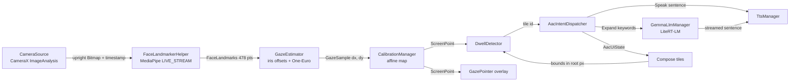
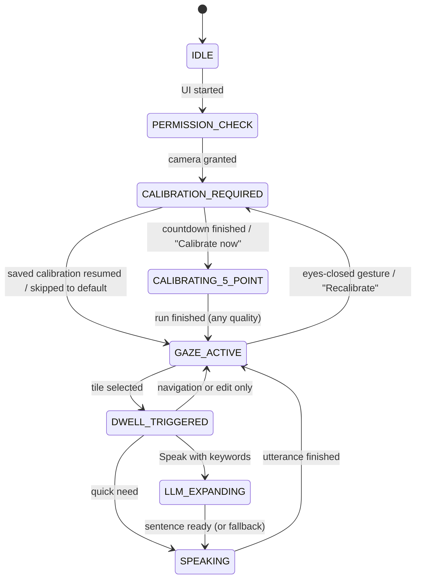

# Vakyam architecture

## 1. Overview

Vakyam is a single-activity Compose app with three layers:

| Layer | Package | Rule |
|---|---|---|
| UI | `ui`, `ui.components`, `ui.theme` | Renders state, forwards events. No logic. |
| ViewModel | `ui.GazeViewModel`, `state` | Wires the pipeline together and owns the app state machine. |
| Domain / managers | `camera`, `vision`, `gaze`, `calibration`, `dwell`, `aac`, `llm`, `tts` | One responsibility each. They do not know about each other or about Compose. |

`gaze`, `calibration` (except the SharedPreferences store), `dwell`, `aac`, `state` and
`llm.AacPromptTemplate` are plain Kotlin with no Android dependencies, which is why they are covered
by JVM unit tests.

## 2. Data flow



Everything between `FaceLandmarkerHelper` and `DwellDetector` runs inside `GazeViewModel.onFace`,
once per camera frame. `GazeViewModel` is the only class that knows the whole chain.

### Threads

| Work | Thread |
|---|---|
| Frame copy and rotation (`CameraSource.analyze`) | `Dispatchers.Default.limitedParallelism(1)` used as the CameraX analyzer executor |
| Landmark inference | MediaPipe's own graph threads |
| Gaze maths, calibration sampling, dwell (`GazeViewModel.onFace`) | MediaPipe result-callback thread |
| Model loading and generation (`GemmaLlmManager`) | `Dispatchers.IO` |
| Landmarker creation | `Dispatchers.Default` |
| State transitions that drive UI, AAC reducer, TTS calls | Main (`viewModelScope`) |

Nothing heavy runs on the main thread. Classes touched from more than one thread
(`AppStateMachine`, `CalibrationManager`, `DwellDetector`, `FaceLandmarkerHelper`) synchronise
internally; UI-facing values are `StateFlow`s.

### Frame lifecycle

`CameraSource.analyze` wraps its work in `try / catch / finally { image.close() }`. A frame that
fails to convert is logged and dropped; the proxy is closed on every path, because an unclosed
`ImageProxy` stops CameraX from delivering further frames. Backpressure is
`STRATEGY_KEEP_ONLY_LATEST`, so a slow frame costs frame rate, never a growing queue.

## 3. Gaze estimation

### 3.1 Orientation

The front sensor of a portrait phone delivers landscape frames with
`imageInfo.rotationDegrees = 270`. `CameraSource` rotates each RGBA frame by that amount before
detection, so the landmarker always sees an upright face and landmark coordinates are in the
upright image. The image is not mirrored; the left/right sign is absorbed by calibration.

The activity is locked to portrait because the calibration maps to screen pixels of one
orientation.

Landmarks are normalised by image width and height separately. Since the image is not square
(480 × 640), all geometry is done in pixels: `p = (x · W, y · H)`.

### 3.2 Iris offsets

For each eye, with corners **a**, **b** and iris centre **c** (pixels):

```
e  = b − a                          eye axis
w² = e · e                          squared eye width
d  = c − a

h  = (d · e) / w² − 0.5             horizontal offset: projection on the axis, centred
v  = (e × d) / w²                   vertical offset: perpendicular distance in eye widths
     where e × d = eₓ·d_y − e_y·dₓ
```

| Eye (MediaPipe naming) | a | b | iris | upper lid | lower lid |
|---|---|---|---|---|---|
| Left | 33 | 133 | 468 | 159 | 145 |
| Right | 362 | 263 | 473 | 386 | 374 |

Both axes run the same direction across the image, so the two eyes share a sign convention and are
averaged:

```
dx = (h_left + h_right) / 2
dy = (v_left + v_right) / 2
```

Because the offsets are expressed in each eye's own frame and divided by eye width, they do not
change when the head translates in the image, rolls, or moves nearer or further. They do change
with head yaw and pitch; see section 9.

Sign convention in the unmirrored image: looking towards the right edge of the screen lowers `dx`;
looking down raises `dy`.

Eye openness is `|upper lid − lower lid| / w`. Below 0.07 the eyes count as closed (looking down at
the bottom of the screen still reads about 0.12–0.18): the sample is
flagged, the filter is not updated, and the pointer holds its position.

### 3.3 Smoothing

`dx` and `dy` each pass through a One-Euro filter:

```
α(f_c, Δt) = 1 / (1 + 1 / (2π · f_c · Δt))
ẋ_i   = lerp(ẋ_{i−1}, (x_i − x̂_{i−1}) / Δt, α(f_d, Δt))        f_d = 1 Hz
f_c   = f_min + β · |ẋ_i|                                        f_min = 1.2 Hz, β = 6
x̂_i   = lerp(x̂_{i−1}, x_i, α(f_c, Δt))
```

During a fixation the cutoff sits near 1.2 Hz and removes landmark noise and micro-saccades. During
a saccade the speed term opens the cutoff so the pointer follows without noticeable lag. `β` is
large because the signal is small: a glance across the screen is about 0.1 of `dx`, so real eye
movements are only a couple of units per second.
Calibration uses the unfiltered offsets and takes a median instead.

The on-screen pointer is additionally spring-animated in Compose. That is cosmetic; dwell detection
uses the filter output directly.

## 4. Calibration

### 4.1 Procedure

Five targets, as fractions of the screen: centre (0.5, 0.5), then (0.12, 0.10), (0.88, 0.10),
(0.12, 0.90), (0.88, 0.90). For each target:

1. **Settle**, 1.0 s – the eye travels to the dot; samples are ignored.
2. **Collect**, 1.2 s and at least 12 valid samples – raw offsets are recorded.
3. The point's observation is the **median** `dx` and median `dy`, paired with the target's pixel
   position.

If the eyes are not visible for more than 400 ms, the current point restarts, so looking away never
records bad data. Section 4.3 describes the time budget that stops this from repeating forever.

### 4.2 Affine regression

Model, with six unknowns:

```
X = a₀ + a₁·dx + a₂·dy
Y = b₀ + b₁·dx + b₂·dy
```

With `n = 5` observations `(dxᵢ, dyᵢ) → (Xᵢ, Yᵢ)` this is two independent least-squares problems
sharing the design matrix `A = [1  dx  dy]`:

```
a = argmin ‖A·a − X‖²   ⇒   AᵀA · a = AᵀX          (and likewise for b with Y)
```

The offsets are small numbers (about ±0.1), so `AᵀA` is poorly scaled. The solver standardises
them first:

```
u = (dx − μ_dx) / σ_dx        v = (dy − μ_dy) / σ_dy
```

Then `Σu = Σv = 0` and `Σu² = Σv² = n`, and the normal equations collapse to

```
c₀ = mean(X)

[ n  S ] [c₁]   [Σ uᵢXᵢ]                         n·Σu·X − S·Σv·X          n·Σv·X − S·Σu·X
[ S  n ] [c₂] = [Σ vᵢXᵢ]      S = Σ uᵢvᵢ    c₁ = ───────────────    c₂ = ───────────────
                                                     n² − S²                  n² − S²
```

and are mapped back:

```
a₁ = c₁ / σ_dx      a₂ = c₂ / σ_dy      a₀ = c₀ − a₁·μ_dx − a₂·μ_dy
```

Five points for three parameters per axis leaves two degrees of freedom to average out noise.

### 4.3 Fallbacks: calibration never fails

A calibration run always ends with a usable mapping and the board always opens. A user who cannot
get past calibration cannot communicate at all, so a rough pointer plus a visible warning is
better than a loop. `AffineSolver.solve` tries, in order:

| Quality | Used when | Mapping |
|---|---|---|
| `FITTED` | The affine fit exists and its RMS residual is at most 12 % of the screen diagonal | Section 4.2 |
| `APPROXIMATE` | The affine fit is degenerate (`σ_dx` or `σ_dy` < 1e-6, or `1 − (S/n)² < 0.05`) or its residual is too large | Axis-aligned, below |
| `DEFAULT` | Neither axis could be measured, or calibration was skipped | Built-in gains, below |

**Axis-aligned fit.** X depends on `dx` only and Y on `dy` only (`a₂ = b₁ = 0`). For X, with the
targets left of centre as group L and those right of centre as group R:

```
a₁ = (mean X_R − mean X_L) / (mean dx_R − mean dx_L)
a₀ = mean X_L − a₁ · mean dx_L
```

and likewise for Y with the top and bottom targets. An axis is measured only if both groups have
samples and their offsets differ by at least 0.010 (`dx`) or 0.015 (`dy`); otherwise that axis
alone uses the built-in gain. Two numbers per axis are far harder to get wrong than six, at the
cost of ignoring cross-talk.

**Built-in gains.** Full screen width corresponds to a `dx` change of 0.10 and full height to a
`dy` change of 0.18, with the signs of the unmirrored camera image (X falls as `dx` rises, Y rises
with `dy`):

```
X = W/2 − (W / 0.10) · (dx − dx_c)
Y = H/2 + (H / 0.18) · (dy − dy_c)
```

`(dx_c, dy_c)` is the offset measured at the centre target, or, when calibration is skipped, the
user's gaze at the moment the button is pressed.

**No dead ends in the flow either.** Each point has an 8 s budget, counted only while a face is in
view. When it runs out the point is recorded if it has at least 3 samples and skipped otherwise,
so eyes that cannot be read at one target (for example lids misread as closed) cannot stall the
run. With no face at all the run waits.

The board's status line shows "Rough calibration" or "Default calibration" with the recalibration
gesture whenever the quality is not `FITTED`.

### 4.4 Use and persistence

At run time `(X, Y) = map(dx̂, dŷ)` with the filtered offsets, clamped to the screen. The six
coefficients, the screen size, the RMS error and the quality are stored in SharedPreferences
(`vakyam_calibration`). `DEFAULT` results are not stored, so they never replace a real calibration.
A stored calibration is reused only if the screen size matches exactly.

All coordinates (targets, gaze points, tile bounds) are pixels in the Compose root, which fills the
window edge to edge.

## 5. Dwell selection

`DwellDetector` holds the registered targets (tile id → bounds) and one timer.

| Parameter | Default | Purpose |
|---|---|---|
| Dwell | 700 ms (Speak: 1000 ms) | Time the gaze must rest on a tile |
| Hysteresis | 28 px | The tile being dwelled on is hit-tested with enlarged bounds, so edge jitter does not jump to a neighbour |
| Grace | 180 ms | A blink or brief exit does not reset the timer |
| Cooldown | 600 ms | After a selection nothing can be dwelled on, so the tile that appears under the gaze does not fire by accident |

Progress (0–1) is published as a `StateFlow<DwellState>`; `GazeTile` reads it in the draw phase
only, so the ring animates without recomposition.

## 6. App state machine



The table lives in `AppStateMachine.ALLOWED`; any other transition is refused. Navigation is a pure
function of the state (`routeFor` in `GazeApp.kt`).

## 7. LLM

- **Runtime:** LiteRT-LM (`com.google.ai.edge.litertlm:litertlm-android`). The `.litertlm` Gemma 4
  bundle targets this runtime; MediaPipe's `tasks-genai` LLM Inference API is in maintenance mode
  and expects a different (`.task`) bundle. MediaPipe is still used for vision.
- **Backend:** CPU by default. Set `LLM_PREFER_GPU` to try GPU first with CPU fallback.
- **Context:** 1024 tokens, at most 64 output tokens. Text only; the vision and audio encoders in
  the bundle are not initialised.
- **Prompt:** one system instruction plus four user/model example pairs as the conversation
  preface, then `Keywords: a, b, c`. Sampling: top-k 20, top-p 0.9, temperature 0.3.
- **Warm conversation:** each request uses a fresh conversation so sentences never influence each
  other. The next conversation is created right after the previous request finishes, so the preface
  is processed while the app is idle.
- **Output:** chunks are accumulated; the first non-empty line, stripped of quotes and labels, is
  emitted after every chunk and shown in the sentence bar.
- **Failure:** model missing, load failure or a 30 s timeout all end in the same place: whatever
  was generated is spoken, or else the keywords themselves.

## 8. Memory and latency

These are design estimates for the S23 FE. **They have not been measured on a device yet.** Check
with `adb shell dumpsys meminfo com.vakyam.app` and the `GemmaLlmManager` / `GazeViewModel` logs.

### Memory budget (target: under 2.5 GB)

| Component | Estimate | Notes |
|---|---|---|
| Gemma 4 E2B weights (text decoder) | 1.2–1.7 GB | Memory-mapped from the 2.6 GB file. File-backed pages are reclaimable by the kernel, and the vision/audio sections are never touched. |
| KV cache and runtime buffers | 100–250 MB | Bounded by the 1024-token context |
| MediaPipe Face Landmarker | 30–60 MB | Three small models on CPU |
| CameraX, ImageAnalysis only | 30–60 MB | 640 × 480 RGBA, no preview surface |
| Frame bitmaps | under 10 MB live | One reused buffer plus one rotated copy per frame (about 1.2 MB each) |
| Compose UI, ART heap, TTS client | 100–180 MB | |
| **Total** | **about 1.5–2.3 GB** | |

Choices made for the budget: CPU inference so weights stay memory-mapped (the GPU backend copies
them into GPU memory, roughly +1 GB); a small context window; VGA analysis frames; no camera
preview; one conversation at a time.

### Latency expectations

| Stage | Estimate |
|---|---|
| Camera frame to gaze point | 20–35 ms (copy and rotate 2–4 ms, landmarks 10–25 ms on CPU) |
| Gaze update rate | 25–30 Hz |
| Dwell | 700 ms by design |
| Model load at startup | 5–15 s, in the background; the board is usable meanwhile |
| Sentence: first token | 0.3–1 s (the preface is already processed) |
| Sentence: complete (10–20 tokens) | 1–3 s on CPU at roughly 8–20 tokens/s |
| Speech start | 100–300 ms |

The Exynos 2200 and Snapdragon 8 Gen 1 variants should be close on CPU. Sustained use will throttle
both, so expect the slow end of each range after several minutes.

## 9. Known limitations

- **Head pose.** The affine model has no head-rotation term. Turning or tilting the head after
  calibration shifts the pointer. A fixed phone mount and a supported head work best.
- **Vertical resolution.** The iris moves much less vertically than horizontally and the upper lid
  follows the gaze downward, so vertical accuracy is worse than horizontal. The board therefore
  uses few, tall rows.
- **Accuracy.** Expect tile-sized accuracy, not pixel accuracy. The layout is two columns with at
  most four rows for that reason.
- **Glasses and lighting.** Reflections on lenses and strong backlight degrade iris landmarks.
- **Language.** Vocabulary, prompt and examples are English; TTS uses the device locale when it has
  a voice and otherwise US English.
