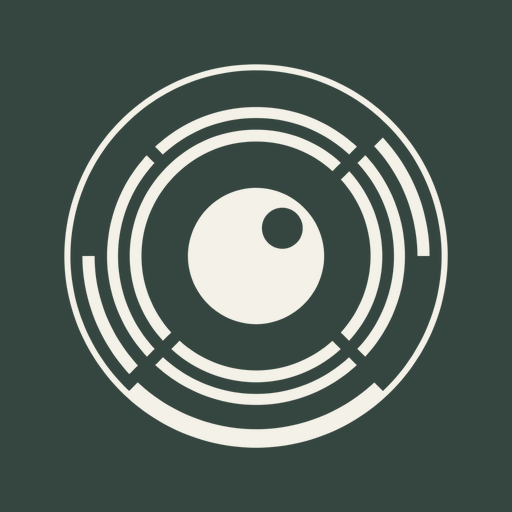
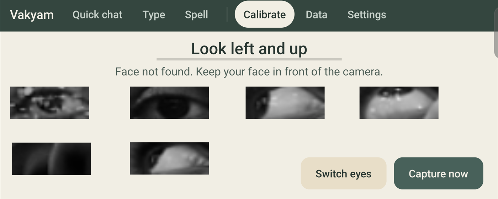
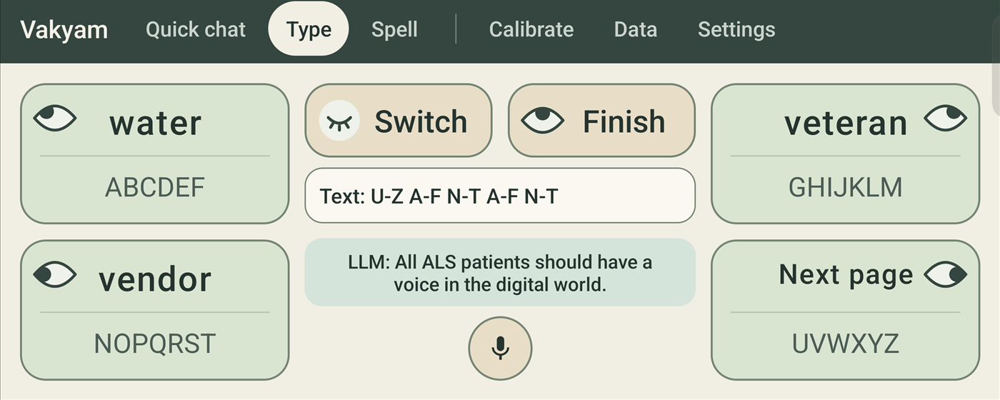
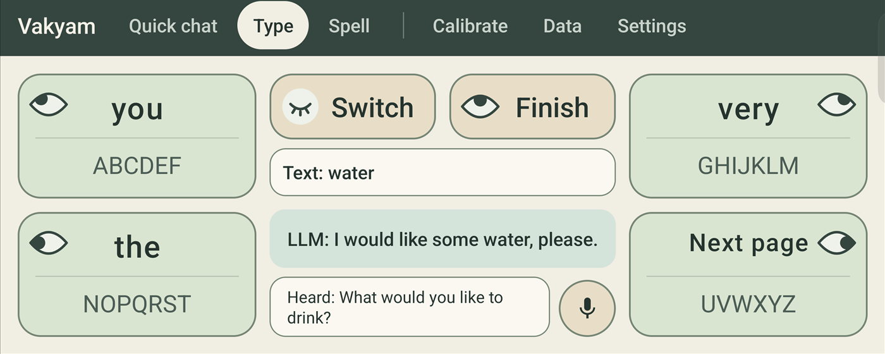
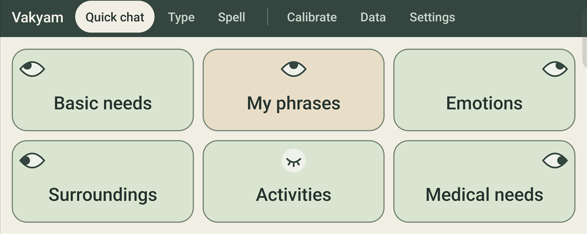
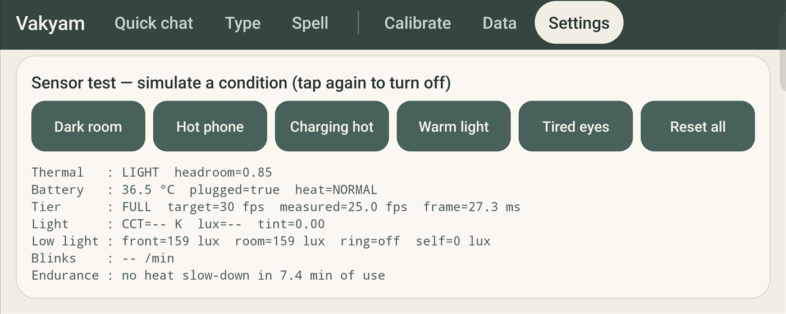
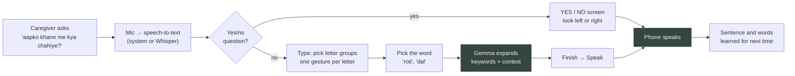
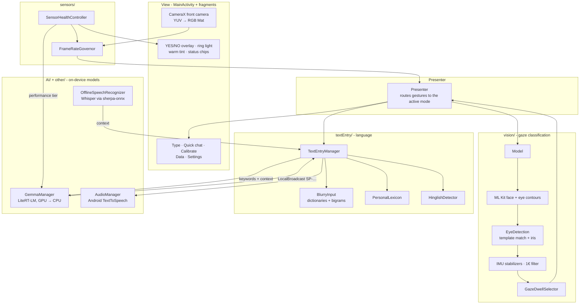
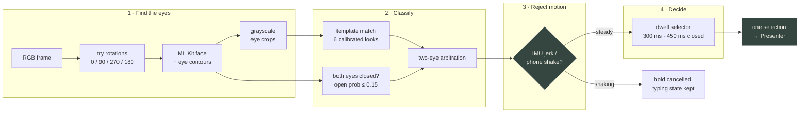

<div align="center">



# Vakyam

<sub>वाक्यम् · <i>sentence</i></sub>

<br/>

**Gaze → Keywords → Sentence → Voice**

An Android AAC app for people who cannot speak or move. The front camera reads six eye
gestures, an ambiguous keyboard turns them into keywords, an on-device Gemma model expands
the keywords into a full sentence, and the phone says it aloud - in English or Hinglish,
with no cloud and no extra hardware.

<br/>

[-3ddc84?style=for-the-badge&logo=android&logoColor=white)](https://developer.android.com/)
[](#on-device-sentence-generation)
[](#english-and-hinglish)

[](https://kotlinlang.org/)
[](https://openjdk.org/)
[](https://opencv.org/)
[](https://developers.google.com/ml-kit/vision/face-detection)
[](https://ai.google.dev/edge/litert)
[](https://ai.google.dev/gemma)
[](https://github.com/k2-fsa/sherpa-onnx)

</div>

---

> **The patient must never speak a bare word.** Whatever the model returns - nothing, an echo
> of the keywords, the wrong script, or a timeout - Vakyam still produces a complete,
> first-person sentence, and it never needs a network connection to do so.

> **Note on this README.** Every number below (dwell times, thresholds, frame rates, model
> sizes) is read from the source in this repository, with the file linked next to it. Every
> screenshot was captured over `adb` from the app running on an iQOO 13, cropped to remove the
> system status bar; nothing is mocked.

---

## Table of contents

- [Overview](#overview) · [Why this is different](#why-this-is-different)
- [Product walkthrough](#product-walkthrough) · [A complete conversation](#a-complete-conversation)
- [System architecture](#system-architecture) · [Repository structure](#repository-structure) · [The gaze pipeline](#the-gaze-pipeline)
- [Algorithms](#algorithms) · [On-device sentence generation](#on-device-sentence-generation) · [English and Hinglish](#english-and-hinglish)
- [Sensor safeguards](#sensor-safeguards) · [Visual gallery](#visual-gallery) · [Technology stack](#technology-stack)
- [Installation](#installation) · [Running](#running) · [Debug hooks](#debug-hooks)
- [Feature matrix](#feature-matrix) · [Testing](#testing) · [Roadmap](#roadmap)
- [Documentation](#documentation) · [Acknowledgements](#acknowledgements) · [License](#license)

---

## Overview

People with ALS, motor neuron disease and similar conditions often lose speech and limb
movement while keeping control of their eyes. Dedicated eye-tracking communicators exist, but
they need an infrared tracker, a mounted tablet and a budget most families do not have.

**Vakyam** (वाक्यम्, Sanskrit for *sentence*) does the same job with the phone already in the
house. The front camera watches the eyes; the patient looks **left, right, up, up-left,
up-right, or closes their eyes** to pick one of six on-screen options. That is the entire
input vocabulary - six gestures - and everything else in the app exists to get the most
language out of them.

Typing letter by letter with six gestures is slow, so Vakyam asks for less. The patient picks
a few **keywords** on a four-group ambiguous keyboard, and an on-device **Gemma 4 E2B** model
expands them into a natural sentence that answers whatever the caregiver just asked. The
phone then speaks it.

---

## Why this is different

| | Typical camera-based AAC | **Vakyam** |
|---|---|---|
| Hardware | IR tracker or mounted tablet | **any Android 8.0+ phone**, front camera only |
| Sentence building | letter by letter | **keywords → full sentence** by an on-device LLM |
| Connectivity | cloud speech / cloud LLM | **fully offline**: Gemma via LiteRT-LM, Whisper via sherpa-onnx |
| Language | English | **English and Hinglish**, detected per utterance, spoken in the matching voice |
| Hand-held / in transit | assumes a fixed mount | **IMU circuit breaker**, 1€ filter, scale-invariant iris ratios |
| Accidental input | fixed frame counts | **time-based dwell** that ignores blinks, glances and return saccades |
| Long sessions | none | **thermal tiers, charging-heat alarm, low-light ring, warm tint, blink-rate rest reminder** |
| Personalisation | static dictionary | **personal lexicon** shared by every input mode |
| Evidence | anecdotal | built-in **typing-speed test** (WPM, error %, selections per character) with CSV export |

---

## Product walkthrough

The top bar has six destinations. Every gaze target can also be tapped, so a caregiver can
always step in.

### 1 - Calibrate

Six looks, captured automatically: straight, left, right, up, left-up, right-up. The app
speaks each instruction, waits for the gaze to hold steady, beeps, and stores one eye-crop
template per eye per direction.



- **Hands-free capture:** [`CalibrationStabilityGate`](app/src/main/java/com/demo/opencv/vision/CalibrationStabilityGate.kt)
  captures a step once the smoothed iris position has been steady for 400 ms, after a 700 ms
  settle. It subtracts gyro-explained movement so a hand-held phone still calibrates, and
  becomes more lenient each time a step has to be re-prompted.
- **No duplicate templates:** [`CalibrationTemplateCheck`](app/src/main/java/com/demo/opencv/vision/CalibrationTemplateCheck.kt)
  rejects a capture that looks like an earlier one, so "up" can never be stored while the
  patient was still looking straight.
- **Live status:** "Face not found", "Keep your eyes open", "Hold the phone still",
  "Move your eyes further in that direction".

### 2 - Type

The main screen. Six options, one per gesture, in two alternating layers:

| Gesture | Letter layer | Word layer |
|---|---|---|
| Left-up | `ABCDEF` | word 1 |
| Right-up | `GHIJKLM` | word 2 |
| Left | `NOPQRST` | word 3 |
| Right | `UVWXYZ` | next page |
| Up | delete | finish |
| Eyes closed | switch layer | switch layer |


Each tile carries an eye badge whose pupil shows where to look. After the five gestures for
`water` (`U-Z A-F N-T A-F N-T`), closing the eyes switches to the word layer, where the
matching words are waiting:



Each letter costs **one gesture**: the patient picks the *group*, not the letter, and
[`BlurryInput`](app/src/main/java/com/demo/opencv/textEntry/BlurryInput.java) resolves the
group sequence against the dictionary (see [ambiguous keyboard](#four-group-ambiguous-keyboard)).
Each chosen word becomes a keyword, and after every word Gemma regenerates the sentence shown
under the keys. **Finish** opens a two-option screen: speak the sentence, or go back.


Three text-entry modes are available in Settings: *letter by letter* (a two-step keyboard in
[`KeyboardManager`](app/src/main/java/com/demo/opencv/textEntry/KeyboardManager.java) that can
spell anything, including names), *ambiguous keyboard only*, and *ambiguous keyboard + LLM*.

### 3 - Hear the question

The record button transcribes what the caregiver says and feeds it to the model as
**context**, so the keywords `chicken` after "What do you want for dinner?" become
*"I want to have chicken for dinner."* Online it uses Android's `SpeechRecognizer`; offline,
or when the system recogniser fails, [`OfflineSpeechRecognizer`](app/src/main/java/com/demo/opencv/other/OfflineSpeechRecognizer.kt)
records 16 kHz audio and transcribes it with Whisper on the device.



> Here the single keyword `water` and the question *"What would you like to drink?"* became
> *"I would like some water, please."* - generated by Gemma on the phone's CPU in 1.36 s
> (`GemmaTiming` log for this exact capture).

### 4 - Yes / No

If the sentence the caregiver said is a yes/no question, typing is skipped entirely: a
full-screen **YES** (look left) and **NO** (look right) take over, with "back to typing" on
look-up. [`YesNoQuestion`](app/src/main/java/com/demo/opencv/yesno/YesNoQuestion.kt) decides
this from sentence structure alone, in English ("are you…", "do you…") and Hinglish
("…hai kya", "…na"), and steps aside for question words and either/or choices.

### 5 - Quick chat

Five categories - basic needs, emotions, surroundings, activities, medical needs - of
ready-made sentences reachable in two gestures, plus **My phrases**: sentences the patient
has actually spoken before, learned automatically.

| | |
|---|---|
|  |  |
| **Categories** - one gesture each | **Basic needs** - one more gesture speaks the sentence |

### 6 - Spell (blink keyboard)

A second input method for users who can blink reliably but cannot hold a directional gaze. A
QWERTY grid is scanned row by row, then key by key
([`ScanningEngine`](app/src/main/java/com/demo/opencv/features/blinkkeyboard/ScanningEngine.kt));
a deliberate blink of 350-1200 ms selects. Blinks under 250 ms are treated as involuntary and
ignored, and holding the eyes closed for 1.8 s pauses scanning
([`BlinkDetector`](app/src/main/java/com/demo/opencv/features/blinkkeyboard/BlinkDetector.kt)).
The closed-eye threshold adapts to each user's own open-eye aspect ratio.


### 7 - Data and Settings

**Data** shows the gaze input log and runs the [typing-speed test](#typing-speed-test).
**Settings** holds language, text-entry mode, sensitivity and lighting threshold, plus a live
**Sensor Health** panel and buttons that simulate a dark room, hot phone, hot charger, warm
light and tired eyes.



With **Dark room** switched on, the low-light policy draws a soft white ring round the screen
edge to light the face for the camera:


---

## A complete conversation



1. The caregiver presses record and asks a question; the transcript appears as `Heard: …`.
2. The patient types `roti` and `dal`, a handful of gestures each.
3. Gemma returns *"Mujhe roti aur dal khani hai."* - Hinglish, because the keywords were.
4. The patient looks up (**Finish**), then left (**Speak**). The Hindi voice says it.
5. Both words and the whole sentence go into the personal lexicon and are offered first
   next time, in every input mode.

---

## System architecture

Model-View-Presenter. The camera analyzer, the sensor controller and the LLM each run off
the main thread and meet in the presenter.



**Modules.**

- **`vision/`** - everything between a camera frame and a deliberate selection.
- **`textEntry/`** - keyboards, dictionaries, Hinglish detection, quick chat.
- **`AI/`** - [`GemmaManager`](app/src/main/java/com/demo/opencv/AI/GemmaManager.kt), the only
  class that talks to the LLM. `GeminiManager` is a thin adapter kept from the cloud version
  so callers did not have to change.
- **`sensors/`** - pure policy classes (inputs → decision, injected clock) wrapped by Android
  monitors and wired together in [`SensorHealthController`](app/src/main/java/com/demo/opencv/sensors/SensorHealthController.kt).
- **`features/blinkkeyboard/`**, **`yesno/`**, **`metrics/`**, **`personal/`** - self-contained
  features, each with its own tests.

---

## Repository structure

```
Vakyam/
├── app/                              # Android application (applicationId com.vakyam.app)
│   ├── build.gradle                  #   minSdk 26 · targetSdk 34 · Java/Kotlin 17
│   ├── libs/                         #   vendored sherpa-onnx AAR (offline speech-to-text)
│   └── src/
│       ├── main/
│       │   ├── assets/               # EnglishWords · EnglishBigrams · HinglishWords · HinglishBigrams
│       │   ├── java/com/demo/opencv/
│       │   │   ├── MainActivity.java         # View: CameraX analyzer, tabs, overlays
│       │   │   ├── Presenter.java            # routes gestures to the active mode
│       │   │   ├── UserDataManager.java      # Application: settings + calibration templates
│       │   │   ├── AI/                       # GemmaManager (LiteRT-LM) · GeminiManager (adapter)
│       │   │   ├── vision/                   # Model · EyeDetection · GoogleFaceDetector
│       │   │   │                             #   GazeDwellSelector · BallisticGestureDetector
│       │   │   │                             #   NormalizedIrisEstimator · OneEuroFilter
│       │   │   │                             #   MotionSensorStabilizer · PhoneMotionTracker
│       │   │   │                             #   CalibrationStabilityGate · CalibrationTemplateCheck
│       │   │   ├── textEntry/                # TextEntryManager · BlurryInput · KeyboardManager
│       │   │   │                             #   QuickChatManager · HinglishDetector · HinglishLexicon
│       │   │   ├── features/blinkkeyboard/   # ScanningEngine · BlinkDetector · EyeClosureEstimator
│       │   │   ├── yesno/                    # YesNoQuestion · YesNoController · YesNoOverlay
│       │   │   ├── sensors/                  # thermal · battery · CCT · low light · blink rate
│       │   │   ├── metrics/                  # TypingTest · TypingTrial · TrialReport
│       │   │   ├── personal/                 # PersonalLexicon · PrefsLexiconStore
│       │   │   ├── other/                    # AudioManager (TTS) · OfflineSpeechRecognizer
│       │   │   └── fragments/                # one fragment per screen
│       │   ├── res/                          # layouts, gaze icons, values + values-hi
│       │   └── ic_launcher-playstore.png     # the app logo
│       ├── test/                             # JVM unit tests (no device needed)
│       └── androidTest/                      # on-device Gemma inference test
├── opencv/                           # vendored OpenCV Android SDK 4.7.0
├── docs/
│   ├── user-manual.pdf
│   ├── sensors/                      # design notes for each sensor safeguard
│   └── assets/screenshots/           # README screenshots, captured from the device
├── tools/telemetry/                  # ADB scripts for reading device sensors
└── Models/                           # local staging for on-device models (git-ignored)
```

---

## The gaze pipeline

One camera frame, start to finish
([`Model.classifyGaze`](app/src/main/java/com/demo/opencv/vision/Model.java)):



Before calibration, a second path keeps the app usable: the iris centre is located in the eye
crop, converted to scale-invariant ratios, smoothed by a 1€ filter, and fed to a saccade
detector that recognises left, right and up flicks. Once the six templates exist, they take
over - a flick can only say left/right/up and would otherwise swallow the upper corners.

---

## Algorithms

### Template matching on mean-removed eye crops

[`EyeDetection`](app/src/main/java/com/demo/opencv/vision/EyeDetection.java) compares each
eye crop against that eye's six calibration templates with mean squared error **after
subtracting each image's mean brightness**, so exposure drift and screen glow after
calibration do not shift the result. A match must be under the user's sensitivity setting
*and* clearly better than the runner-up (best ≤ 0.9 × second-best), otherwise the frame is
unreadable rather than wrong.

When the two eyes disagree, `Model.analyzeGazeOutput` trusts the eye on the side being looked
toward, and otherwise picks the template with the lowest summed error across both eyes.

### Time-based dwell selection

[`GazeDwellSelector`](app/src/main/java/com/demo/opencv/vision/GazeDwellSelector.kt) turns
per-frame classifications into deliberate input.

```
hold(direction) ≥ 300 ms  and ≥ 3 frames      → select
hold(closed)    ≥ 450 ms                      → select   (natural blinks last 100-400 ms)
one contradicting frame                       → tolerated
two in a row, or > 1 in 5                     → hold restarts
after a selection                             → 300 ms lockout, then must look away to re-arm
```

It is **time based, not frame based**, because the camera runs anywhere from 10 to 30 fps
depending on the thermal tier and the light; a fixed frame count would mean a different hold
time on every phone.

### Motion circuit breaker

When a wheelchair hits a kerb, the head and the phone both jolt and the vestibulo-ocular
reflex moves the eyes involuntarily.
[`MotionSensorStabilizer`](app/src/main/java/com/demo/opencv/vision/MotionSensorStabilizer.kt)
computes jerk from the accelerometer, `J(t) = ‖da/dt‖`, and on a spike opens a 300 ms
motion-hold window in which no gesture is evaluated. Typing state is kept, never reset.
[`PhoneMotionTracker`](app/src/main/java/com/demo/opencv/vision/PhoneMotionTracker.kt)
separately integrates the gyroscope to tell a real shake (> 1.2 rad/s) from ordinary hand
tremor (< 0.3 rad/s).

### Scale-invariant iris ratios and the 1€ filter

[`NormalizedIrisEstimator`](app/src/main/java/com/demo/opencv/vision/NormalizedIrisEstimator.kt)
expresses the iris centre relative to the eye's own landmarks:

```
horizontalRatio = proj(iris − innerCanthus, corner baseline) / baseline length     # ~0.5 centred
verticalRatio   = proj(iris − upperLid,     eyelid aperture) / aperture height
```

Moving the phone from 30 cm to 50 cm scales the landmarks and the iris displacement by the
same factor, so the ratios do not change. They are smoothed with a
[1€ filter](app/src/main/java/com/demo/opencv/vision/OneEuroFilter.kt) (Casiez et al.): low
cutoff while fixating to remove vibration, cutoff rising with speed so a saccade is not lagged.

### Ballistic saccade detection

[`BallisticGestureDetector`](app/src/main/java/com/demo/opencv/vision/BallisticGestureDetector.kt)
fires on a flick only when the ratio exceeds **both** a velocity threshold (1.8 normalised
units/s) and a displacement threshold (0.18 from centre). Road vibration is oscillatory and
low-amplitude and never satisfies both; a 400 ms lockout prevents double firing.

### Four-group ambiguous keyboard

```
group 0 = a-f     group 1 = g-m     group 2 = n-t     group 3 = u-z

"water" → w a t e r → 3 0 2 0 2          # five gestures, not five letter searches
```

[`BlurryInput`](app/src/main/java/com/demo/opencv/textEntry/BlurryInput.java) precomputes the
group code of every dictionary word and returns the words whose code starts with what has
been typed, three per page. Ranking puts words the patient usually says after the previous
word first, then bigram followers of that word, then the patient's other learned words, then
words drawn from the caregiver's question, and finally the frequency-ordered English
(5,000 words) and Hinglish (~1,000 words) lists, ordered by which language is being typed.

### Typing-speed test

[`metrics/`](app/src/main/java/com/demo/opencv/metrics) implements the standard text-entry
measures so results can be compared with published AAC numbers: words per minute at five
characters per word, error rate as minimum string distance over the longer string, and
selections per character. The clock starts at the first eye selection and stops when the
sentence is spoken. Each result is stored with the input mode (`gaze-letter`,
`gaze-ambiguous`, `gaze-llm`, `blink`) and the sensor conditions at the time, and the log can
be shared as CSV from the Data screen.

---

## On-device sentence generation

[`GemmaManager`](app/src/main/java/com/demo/opencv/AI/GemmaManager.kt) runs **Gemma 4 E2B**
through **Google LiteRT-LM**. No API key, no network.

```
system    : role + "expand keywords into ONE natural first-person sentence"
few-shot  : 5 keyword → sentence pairs per language
user turn : "Keywords: {keywords}. Context: {what the caregiver said}"
sampler   : topK 20 · topP 0.9 · temperature 0.3
budget    : 64 output tokens (20 when the phone is warm) · 1024 context · 25 s timeout
```

- **Backend selection.** GPU is tried first, then CPU. Each backend must complete a real test
  inference before it is accepted, because a GPU delegate can initialise and still fail at
  run time.
- **Guard rails.** The reply is discarded and replaced when it is blank, when it contains
  Devanagari (the screen and keyboard are Roman-only), or when it is a single word or just
  repeats the keywords.
- **Deterministic fallback.** `fallbackSentence()` covers the common needs in both languages
  (`water` → *"I would like some water, please."*, `paani` → *"Mujhe paani chahiye."*) and
  wraps anything else in a polite request. It is also what the app uses when the model file
  is missing or the phone is in the `POWER_SAVER` thermal tier.
- **Result delivery.** Sentences come back over `LocalBroadcastManager` tagged `SP-`, so the
  keyboard never blocks on the model.

---

## English and Hinglish

Many Indian families speak Hindi but type it in English letters. Vakyam treats that as a
first-class language rather than a spelling mistake.

- **One keyboard for both.** Hinglish uses the same four letter groups;
  [`HinglishLexicon`](app/src/main/java/com/demo/opencv/textEntry/HinglishLexicon.kt) stores one
  canonical spelling per word plus the variants people actually type (`nahi` ← `nahin`, `nhi`,
  `nai`).
- **Detected per utterance.** With Language = English,
  [`HinglishDetector`](app/src/main/java/com/demo/opencv/textEntry/HinglishDetector.kt) decides
  from the chosen keywords: any Hinglish-only word wins (code-mixing counts as Hinglish), then
  any English-only word, then the caregiver's context, then the previous utterance.
- **That one decision drives three things:** the order of word predictions, which prompt and
  examples Gemma gets, and which voice speaks (Hindi voice for Hinglish, Indian-English or US
  voice otherwise).
- **The caregiver can ask in either.** Both prompts tell the model to read the context by
  meaning - *"dard kahan ho raha hai"* means *"where does it hurt"*.

---

## Sensor safeguards

For someone typing with their eyes 8-14 hours a day, the phone is their only voice. Each
sensor has one job: keep that channel working, or tell the caregiver what is wrong. Full
design notes are in [`docs/sensors/`](docs/sensors/00_SENSOR_INTEGRATION_OVERVIEW.md).

| Safeguard | Reads | Does |
|---|---|---|
| **Thermal tiers** | `PowerManager` thermal status + headroom, battery °C | `FULL` 30 fps → `BALANCED` 24 fps → `POWER_SAVER` 20 fps; face detection on a crop around the last face; shorter LLM output, then LLM deferred to the fallback |
| **Charging heat** | battery thermistor | warm at 42 °C and hot at 45 °C while plugged in: banner, alarm-stream chime that plays through silent mode, spoken *"Caregiver, the phone is overheating. Please unplug the charger."* |
| **Low light** | front lux sensor | below 10 lux a soft white ring is drawn round the screen edge to light the face; the policy subtracts the ring's own light so it cannot switch itself off |
| **Warm tint** | colour-temperature (CCT) sensor | amber overlay up to 14 % alpha as room light warms toward 2700 K, interpolated in mired space |
| **Eye rest** | blink rate from the camera | under 6 blinks/min for a full minute → "Rest your eyes"; closing the eyes for 2 s clears it; at most one reminder per 10 minutes |

Escalation is immediate; recovery is one tier at a time after a 20 s hold, so the app does
not flap between tiers
([`ThermalPolicy`](app/src/main/java/com/demo/opencv/sensors/ThermalPolicy.kt)). The frame
governor never drops below 10 fps because the saccade detector resets on gaps over 200 ms.

---

## Visual gallery

| | |
|---|---|
|  |  |
| **Calibrate** - six eye templates, captured hands-free | **Type, letter layer** - one gesture per letter |
|  |  |
| **Type, word layer** - candidates for one group sequence | **Keyword + question → sentence** |
|  |  |
| **Finish** - speak or go back | **Quick chat** - categories |
|  |  |
| **Quick chat** - ready-made sentences | **Spell** - blink-driven row/column scanning |
|  |  |
| **Sensor Health** - live readings and test buttons | **Ring light** - lights the face in a dark room |

---

## Technology stack

| Layer | Technology |
|---|---|
| **Platform** | Android, minSdk 26, targetSdk 34 · Java 17 + Kotlin 2.4 · AGP 8.13 |
| **Architecture** | Model-View-Presenter · Navigation component · ViewBinding · LiveData |
| **Camera** | CameraX 1.1 (`ImageAnalysis`, front camera) |
| **Face and eye landmarks** | Google ML Kit Face Detection 16.1.5 (contours + eye-open probability) |
| **Image processing** | OpenCV 4.7.0 (vendored Android SDK) |
| **LLM** | Gemma 4 E2B on LiteRT-LM 0.17.1, GPU with CPU fallback |
| **Speech-to-text** | Android `SpeechRecognizer` online · Whisper (base, int8) via sherpa-onnx 1.13.8 offline |
| **Text-to-speech** | Android `TextToSpeech` (US English, Indian English, Hindi voices) |
| **Concurrency** | Kotlin coroutines 1.10.2 |
| **Storage** | Jetpack DataStore (settings, calibration) · SharedPreferences (personal lexicon) |
| **Charts** | MPAndroidChart 3.1.0 |
| **Tests** | JUnit 4 on the JVM, plus one instrumented Gemma test |

---

## Installation

Prerequisites: **Android Studio** (or the Android SDK command-line tools) with **JDK 17**, and
a phone running **Android 8.0+** with USB debugging enabled.

```bash
git clone https://github.com/harshadd-ops/Vakyam.git
cd Vakyam
```

### 1. Build and install the app

**Windows (PowerShell)**

```powershell
.\gradlew.bat :app:assembleDebug
adb install -r app\build\outputs\apk\debug\app-debug.apk
```

**Linux / macOS**

```bash
./gradlew :app:assembleDebug
adb install -r app/build/outputs/apk/debug/app-debug.apk
```

### 2. Push the Gemma model (~2.6 GB)

The model is too large to bundle or commit. Put `gemma-4-E2B-it.litertlm` in `Models/` and
push it:

```bash
adb push Models/gemma-4-E2B-it.litertlm /sdcard/Android/data/com.vakyam.app/files/
```

`GemmaManager` also looks in the app's private `files/` directory, `/data/local/tmp/`,
`/sdcard/Download/` and `/sdcard/Models/`, and will pick up any `*.litertlm` file it finds
there.

### 3. Push the offline speech model (~150 MB, optional)

```bash
mkdir -p Models/asr && cd Models/asr
curl -L -O https://github.com/k2-fsa/sherpa-onnx/releases/download/asr-models/sherpa-onnx-whisper-base.tar.bz2
tar -xjf sherpa-onnx-whisper-base.tar.bz2 --strip-components=1 --wildcards \
    '*/base-encoder.int8.onnx' '*/base-decoder.int8.onnx' '*/base-tokens.txt'
adb push base-encoder.int8.onnx base-decoder.int8.onnx base-tokens.txt \
    /sdcard/Android/data/com.vakyam.app/files/models/asr/
```

`sherpa-onnx-whisper-small.tar.bz2` is a drop-in replacement with better Hindi accuracy at
about three times the size and decode time.

> **Nothing here is mandatory beyond step 1.** Without the Gemma model the app speaks
> fallback sentences; without the Whisper model it uses the system recogniser when online.

---

## Running

| Command (from the project root) | Purpose |
|---|---|
| `.\gradlew.bat :app:assembleDebug` | Build the debug APK → `app/build/outputs/apk/debug/` |
| `.\gradlew.bat :app:installDebug` | Build and install on the connected device |
| `.\gradlew.bat :app:testDebugUnitTest` | Run all JVM unit tests |
| `.\gradlew.bat :app:testDebugUnitTest --tests "com.demo.opencv.sensors.*"` | Run one package |
| `.\gradlew.bat :app:connectedDebugAndroidTest` | Run the on-device Gemma inference test |

First run on the phone: grant camera and microphone access, open **Calibrate**, hold the
phone so your eyes are level with the front camera, press **Start**, and follow the six
spoken prompts. Then open **Type**.

---

## Debug hooks

Debug builds expose a few `adb` broadcasts so every path can be exercised without eyes on
the camera.

```bash
# Generate a sentence straight from keywords
adb shell am broadcast -a com.vakyam.debug.GEMMA --es keywords "paani, thanda" --es language Hinglish

# Stand in for what the microphone heard
adb shell am broadcast -a com.vakyam.debug.SPEAK --es context "What would you like to eat?"

# Speak a sentence and log which voice was chosen
adb shell am broadcast -a com.vakyam.debug.SPEAK --es text "Mujhe paani chahiye"

# Inject a colour temperature reading
adb shell am broadcast -a com.vakyam.debug.SENSOR --ef cct 2700

# Force a thermal status or a hot battery, then always reset
adb shell cmd thermalservice override-status 3
adb shell dumpsys battery set temp 460
adb shell cmd thermalservice reset && adb shell dumpsys battery reset
```

Useful log tags: `GemmaManager`, `GemmaTiming` (per-sentence latency), `SensorHealth`,
`GazeCamera`, `TextGeneration`.

---

## Feature matrix

| Capability | Letter-by-letter gaze | Ambiguous keyboard | **Ambiguous + LLM** | Blink keyboard |
|---|---|---|---|---|
| Input | 6 gaze gestures | 6 gaze gestures | 6 gaze gestures | blink only |
| Gestures per letter | 2 | 1 | 1, and fewer words needed | scan + blink |
| Any word, including names | yes | dictionary + learned | dictionary + learned | yes |
| Word prediction | - | yes | yes | yes |
| Full-sentence output | - | - | **yes** | - |
| Uses caregiver's question | - | - | **yes** | - |
| Hinglish | - | yes | yes | yes |
| Learns from the patient | teaches the lexicon | yes | yes | yes |
| Works offline | yes | yes | yes | yes |

---

## Testing

Every decision that can be separated from Android is a pure class with an injected clock, so
it can be tested on the JVM in milliseconds.

- **294 unit tests in 36 files** under [`app/src/test/`](app/src/test/java/com/demo/opencv),
  covering gaze dwell and arbitration, the calibration gate, IMU stabilisers, the 1€ filter,
  ambiguous-keyboard matching, Hinglish detection, yes/no question detection, the blink
  discriminator and scanner, every sensor policy, the typing metrics, and the Gemma prompt,
  guard rails and fallback.
- **Transit simulation.** `TransitRobustGazeIntegrationTest` and
  `ProfessionalTransitCalibrationHarnessTest` drive the vision stack with synthetic shake
  and vibration.
- **On device.** `GemmaOnDeviceInferenceTest` runs real inference against the pushed model.

```powershell
.\gradlew.bat :app:testDebugUnitTest
```

---

## Roadmap

- **More languages.** The Hinglish work is the template: a word list, bigrams, prompt
  examples and a voice.
- **In-app model download**, so setup does not need `adb`.
- **Release build** with shrinking enabled and a signed APK.
- **Published typing-speed results** from the built-in test, per input mode.

---

## Documentation

- User manual: [docs/user-manual.pdf](docs/user-manual.pdf)
  ([original document](https://docs.google.com/document/d/1Fz6OAjbDfIS6dwi93-o9HvRD_0RV0ealPnbN5Y_3fEQ/edit))
- Sensor safeguards: [docs/sensors/](docs/sensors/00_SENSOR_INTEGRATION_OVERVIEW.md)
- Telemetry and sensor scripts: [tools/telemetry/](tools/telemetry/README.md)

---

## Acknowledgements

- **Google** - Gemma, LiteRT-LM and ML Kit Face Detection.
- **OpenCV** - the Android SDK vendored under [`opencv/`](opencv).
- **k2-fsa / sherpa-onnx** and **OpenAI Whisper** - offline speech recognition.
- **Casiez, Roussel and Vogel** - *1€ Filter: A Simple Speed-based Low-pass Filter for Noisy
  Input in Interactive Systems* (CHI 2012).
- **PhilJay / MPAndroidChart** - charts on the Data screen.
- The sensor work was developed and verified on an **iQOO 13**.

---

## License

No licence file has been added to this repository yet. Third-party components keep their own
licences: OpenCV and its dependencies under [`opencv/etc/licenses/`](opencv/etc/licenses),
sherpa-onnx under Apache 2.0, and the Gemma model under Google's Gemma terms of use.

<div align="center">
<br/>
<sub><b>Vakyam</b> - Gaze → Keywords → Sentence → Voice</sub>
</div>
