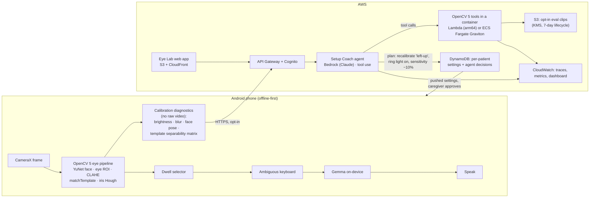

# Vakyam × OpenCV AI Competition 2026 (powered by AWS)

Source: <https://opencv26.devpost.com/> and `/rules`, read 2026-10-17.

**Final deadline: Monday 26 October 2026, 11:59 pm Pacific (Tuesday 27 October, 12:29 pm IST).
That leaves 9 days.**

---

## 1. What the competition requires

Hard requirements. If any of these is missing, the entry is not eligible.

| # | Requirement | Vakyam today | Gap |
|---|---|---|---|
| 1 | **OpenCV 5** does substantive image/video analysis | OpenCV **4.7.0** Android SDK (`opencv/build.gradle`) | **Upgrade to OpenCV 5** |
| 2 | A **meaningful component runs on AWS** | Fully offline, no cloud at all | **Add an AWS component** |
| 3 | Technical report: problem, users, architecture, OpenCV 5 implementation, AWS deployment, evaluation, limitations, responsible use | The README covers most of it except AWS and evaluation | Write the report |
| 4 | Judge-accessible repo with pinned dependencies and build/deploy/test instructions | Repo exists; Gradle versions are pinned | Add AWS deploy steps (IaC) |
| 5 | Architecture diagram that shows the OpenCV 5 **and** AWS components | Mermaid diagrams with no AWS | Redraw |
| 6 | **A working web endpoint** or an arranged live screen-share demo | Android APK only | Web endpoint (recommended) |
| 7 | A video of 5 minutes or less showing the team, the app working, the architecture and the results | None | Record it |
| 8 | Evaluation evidence, **including failure cases** | The typing-speed test exists, but there is no eye-direction accuracy benchmark | Build the benchmark |

Judging rubric (overall):

| Criterion | Weight | Where Vakyam stands |
|---|---|---|
| Technical execution (depth of the OpenCV 5 work) | 30% | Medium. Today OpenCV handles only cvtColor, resize, blur, threshold, contours and a hand-written MSE template match, while ML Kit finds the face. **OpenCV needs to do more of the work.** |
| Innovation | 20% | Strong: six gestures → ambiguous keyboard → LLM sentence, plus Hinglish |
| Real-world impact | 20% | Very strong: ALS/MND AAC on a phone the family already owns |
| User experience / accessibility | 10% | Very strong, and "accessibility" is named in the suggested areas |
| Documentation and presentation | 10% | Strong README to build on |
| Cloud delivery, reproducibility, responsible operation | 10% | Zero today |

Optional special awards ($1,000 each, judged separately):

- **Agentic Vision Award.** An agent runs a perception → decision → action loop in which the
  OpenCV 5 output **changes what the system does next**. A chatbot that only explains a
  vision result does not count. **Vakyam fits this well; see §3.**
- **Best Use of COOL.** COOL (the Cloud-Optimized OpenCV Library) runs the core workload on
  **AWS Graviton**, with benchmarks against a baseline. **This is a weak fit** because Vakyam's
  core workload runs on the phone. Treat it as an optional extra at most (§6).

---

## 2. The pitch, reframed for this competition

> **Vakyam: an eye communicator on any Android phone, powered by OpenCV 5, with an AWS
> agent that sets it up, tunes it and proves it works for each patient.**

The privacy story stays intact: **live conversation never leaves the phone.** AWS handles
only what a phone does badly or what a clinician needs:

1. **The Agentic Setup Coach.** A cloud agent looks at OpenCV 5 diagnostics from a
   calibration session and decides what to do next: recalibrate one direction, switch on
   the ring light, change the sensitivity, or ask the caregiver to reposition the phone.
2. **The Eye Lab.** A web endpoint where a judge (or a clinician) uploads a short face video
   or uses a webcam. The same OpenCV 5 eye pipeline, ported to Python, runs on AWS and
   returns the gesture timeline, the chosen keywords and the generated sentence. **This is
   what meets the "working web endpoint" requirement**, since judges will not sideload an APK.
3. **Evaluation and observability.** Opt-in, de-identified session metrics (WPM, error rate,
   dwell misfires, confusion matrix) go into CloudWatch dashboards for therapists.

---

## 3. Architecture to build

### 3a. Make OpenCV 5 do the heavy lifting (Technical execution, 30%)

Each change replaces hand-written code or ML Kit work with a real OpenCV operation:

| Stage | Today | With OpenCV 5 |
|---|---|---|
| Face + landmarks | ML Kit | **`cv::FaceDetectorYN` (YuNet)** gives the face box and 5 landmarks (keep ML Kit as a fallback or for eye-open probability) |
| Eye crop normalisation | mean subtraction | **CLAHE** + mean removal, so dim rooms and screen glow stop shifting results |
| Template match | hand-written MSE in Java | **`Imgproc.matchTemplate` (TM_SQDIFF_NORMED / TM_CCOEFF_NORMED)** with a small search window, which tolerates a few pixels of crop jitter |
| Iris centre | threshold + contours + moments | add **`HoughCircles`** / distance transform as a second estimator, then fuse the two |
| Image quality gate | coarse lux check | **Laplacian variance** (blur), histogram exposure, and head pose from YuNet landmarks via **`solvePnP`** |
| Optical flow (optional) | IMU only | **`calcOpticalFlowPyrLK`** on face points to separate head motion from eye motion |

Each one has a number to report in the evaluation (§4).

### 3b. The agent loop (Agentic Vision Award)

The rule requires that the vision output change the next action. One loop:

1. **Perceive.** After calibration, the phone sends a diagnostics JSON with no raw video:
   the 6×6 template-distance matrix, per-direction blur/brightness, head yaw/pitch from
   `solvePnP`, and the dwell misfire rate from a 30-second self-test.
2. **Decide.** A Bedrock Claude agent reads it. For example: "left-up and up are confusable
   (distance ratio 0.94 > 0.9); head pitch is 18°; brightness is 42/255."
3. **Act (tool calls).** The agent can call `request_recalibration(direction)`,
   `set_ring_light(on)`, `set_sensitivity(x)`, `ask_caregiver(instruction)` ("raise the phone
   about 10 cm"), and `run_selftest()`.
4. **Re-perceive.** The new diagnostics come back. The agent checks that the confusion is gone
   or tries something else, with at most N iterations before it hands over to a human.
5. **Human control.** Any change to the patient's settings needs **one caregiver tap to
   approve**. Every step goes to CloudWatch as a trace (the "trace showing OpenCV output
   changes a later decision" that the award requires).

The Eye Lab web endpoint runs the same loop server-side on an uploaded video, so judges
can watch it happen without a phone.

---

## 4. Evaluation plan (needed for 30% + Agentic rubric)

1. **Eye-direction classification benchmark.** Record about 10 volunteers × 6 directions × 3 lighting
   conditions (normal, dim, backlit) × 2 holds (mount, hand-held). Report per-direction
   accuracy, a confusion matrix, frames per second and latency per frame.
   **A/B test:** OpenCV 4.7 MSE (old) against OpenCV 5 matchTemplate + CLAHE + YuNet (new).
2. **Text entry.** The built-in typing test (WPM, error %, selections per character) for
   `eye-letter`, `eye-ambiguous` and `eye-llm`. The CSV export already exists.
3. **Agent.** On N bad setups (deliberately dim, tilted or confusable), measure the
   percentage fixed without a human, the average number of iterations, the time to a usable
   calibration, and how often it correctly gave up and asked the caregiver.
4. **Failure cases (required).** Glasses glare, dark irises in low light, nystagmus or
   strabismus, droopy eyelids (ptosis, common in ALS), and Hinglish words missing from the
   lexicon. Show each one honestly.

---

## 5. Responsible-use section (part of the 10% cloud criterion)

- Live speech and eye video **never leave the device**. Cloud features are opt-in and off by
  default.
- Only derived diagnostics are sent by default. Raw clips need separate consent, are
  encrypted with KMS, and are deleted automatically after 7 days.
- Cognito auth, least-privilege IAM roles, no PII in logs, and per-patient data deletion on
  request.
- The agent cannot change settings without caregiver approval and cannot speak for the
  patient.
- State plainly that Vakyam is not a medical device and that the volunteer data is not
  patient data.

---

## 6. Nine-day schedule (17 → 26 Oct)

| Day | Date | Work |
|---|---|---|
| 1 | Sat 17 | Check that an **OpenCV 5 Android SDK** release exists (if not, build from source with `build_sdk.py`). Swap it into `opencv/`. Make the build green. Set up the AWS account (new accounts get Free Tier credits). |
| 2 | Sun 18 | OpenCV 5 pipeline upgrades: `matchTemplate` + CLAHE, YuNet face, quality gate (Laplacian, histogram, `solvePnP`). |
| 3 | Mon 19 | Python port of the eye pipeline (`opencv-python` 5.x), packaged as a container. Lambda arm64 or Fargate. |
| 4 | Tue 20 | Bedrock agent with tool use + DynamoDB + API Gateway/Cognito. CloudWatch traces. |
| 5 | Wed 21 | Phone → cloud diagnostics upload + caregiver-approval UI. Eye Lab web page (S3 + CloudFront). |
| 6 | Thu 22 | Record the benchmark data. Run the A/B and agent evaluations. |
| 7 | Fri 23 | IaC (CDK or SAM) so `cdk deploy` reproduces everything. Pin versions. Write the test instructions. |
| 8 | Sat 24 | Technical report + architecture diagram + failure cases. |
| 9 | Sun 25 | Record and edit the ≤5-minute video. Do a dry run of the endpoint from a clean browser. |
| — | Mon 26 | **Buffer. Submit on Devpost before 11:59 pm PT.** |

**Cut order if time runs short:** optical flow → HoughCircles fusion → hand-held benchmark →
YuNet (keep ML Kit). **Never cut:** OpenCV 5, AWS endpoint, video, report, failure cases.

**COOL award:** skip it unless days 3 to 5 finish early. If they do, run the Eye Lab
container on a Graviton instance with the COOL AMI from AWS Marketplace and benchmark
frames per second and cost per 1,000 frames against stock OpenCV 5 on x86. That gives the
"documented hybrid architecture" the award asks for.

---

## 7. Devpost submission checklist

- [ ] Project page: title, tagline, "Healthcare / Accessibility", paths opted into: **Agentic Vision**
- [ ] Repo link (public, or private with judge access)
- [ ] Technical report (PDF in `docs/`)
- [ ] Architecture diagram (OpenCV 5 + AWS + agent)
- [ ] Agent workflow diagram + a sample trace showing vision output → decision → tool call
- [ ] Working Eye Lab URL (and a fallback: offer a live screen-share)
- [ ] Video of 5 minutes or less: team, phone demo, web demo, architecture, results, a failure case
- [ ] Evaluation tables + confusion matrix + failure cases
- [ ] Pinned deps: Gradle, `requirements.txt` with exact versions, CDK lock file
- [ ] Post with **#OpenCVComp26**

## Open questions for the team

1. Did you register and submit a compute-grant proposal (August)? Registration on Devpost
   is still needed to submit.
2. Does an official OpenCV 5 Android SDK exist yet, or will it have to be built from source?
3. How many people are on the team, and who takes Android, AWS, and the report and video?
