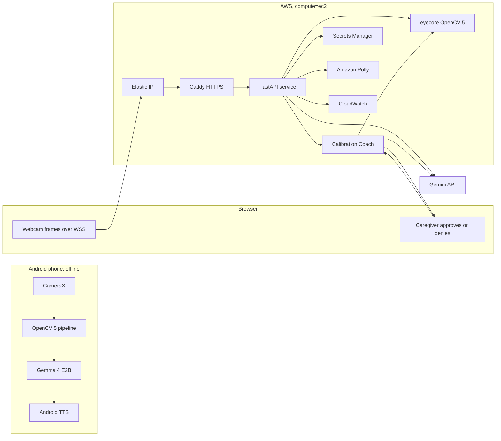

# Vakyam: technical report

OpenCV AI Competition 2026 (powered by AWS). Track: Healthcare / Accessibility. Special award path: Agentic Vision.

Live endpoint: https://eyelab.duckdns.org

Every number in this report comes from a file in this repository, named next to it.

## 1. Summary

People with ALS, motor neuron disease or a stroke often lose speech and limb movement but keep control of their eyes, and dedicated eye-tracking communicators are too expensive for most families. Vakyam is for Hindi-English speaking families who own an ordinary Android phone. It has three parts: an Android app that turns six coarse eye movements into words and speaks a full sentence written by an on-device Gemma 4 E2B model, fully offline; the Eye Lab, a web endpoint on AWS Graviton that runs the same OpenCV 5 pipeline on a browser's webcam; and the Calibration Coach, an agent in the Eye Lab that uses OpenCV 5 measurements to decide how to fix a poor calibration, with a caregiver approving any setting change. In the coach evaluation the agent reached the correct outcome in **11 of 11** fault scenarios. Roll-aligned eye crops keep the error at 0.001-0.003 under a 15° head tilt, against up to 0.163 without alignment, and one Eye Lab frame takes 6.6 ms of server time on a desktop CPU. The app writes "I would like some water, please." from the single keyword "water" in 1.36 s on the phone's CPU.

## 2. Problem and users

The users are Hindi-English speaking families caring for someone with ALS, motor neuron disease or a stroke. They own an Android phone and cannot pay for an infrared tracker and a mounted tablet. No product speaks the way they speak.

Most eye-controlled systems compete on tracker accuracy. Vakyam competes on how few decisions the patient has to make, because a person with ALS tires after a few dozen deliberate eye movements. A phone camera is not accurate enough for a 30-key keyboard, but it is accurate enough for six directions, so the task is designed around that:

- Six coarse gestures: look left, right, up, up-left, up-right, or close the eyes.
- One gesture per letter group, not per letter. Four groups, `a-f`, `g-m`, `n-t`, `u-z`, so "water" is five gestures: `3 0 2 0 2`.
- A sentence from a few keywords. Gemma 4 E2B on the phone expands the keywords into a first-person sentence.
- The caregiver's spoken question is context. After "What would you like to drink?", the keyword `water` became "I would like some water, please." in 1.36 s (`README.md`, `GemmaTiming` log).

The question is transcribed by Android `SpeechRecognizer`, or offline by Whisper through sherpa-onnx. A yes/no question replaces the keyboard with a full-screen YES (look left) and NO (look right). Used words go into a personal lexicon.

The app needs no network: a person should not need the internet to say they are in pain. If the model returns nothing, an echo, Devanagari text, a single word, or times out, a deterministic `fallbackSentence()` still produces a complete sentence. The Eye Lab uses the same fallback when Gemini fails and labels it on screen.

| | Vakyam app (Android) | Eye Lab (web, on AWS) |
|---|---|---|
| Users | patient and caregiver, every day | judges, clinicians, anyone without the APK |
| Vision | on the phone, offline | on AWS Graviton, from the browser webcam |
| Sentence | Gemma 4 E2B (LiteRT-LM) | Gemini API, key in Secrets Manager |
| Voice | Android TextToSpeech | Amazon Polly |
| Agent | none | Calibration Coach |

## 3. Architecture



The browser sends 480 px JPEG frames at up to 15 fps over a secure WebSocket.

One CDK stack (`eyelab/infra/eyelab_stack.py`) has three compute modes behind the same service code and Docker image:

| Mode | Path | Status |
|---|---|---|
| `compute=ec2` | browser → Elastic IP → one EC2 Graviton instance → Caddy → container | live, judged |
| `compute=fargate` (default) | browser → CloudFront → ALB (403 without a secret header) → ECS Fargate arm64 | alternative |
| `compute=cool` | browser → CloudFront → ALB → Graviton4 Auto Scaling group | alternative, not run |

The `cool` mode uses the Cloud Optimized OpenCV (COOL) AMI; this entry does not compete for the COOL award and reports no COOL measurement.

## 4. OpenCV 5 implementation

The app uses `org.opencv:opencv:5.0.0.1` from Maven Central. The Eye Lab uses `opencv-python-headless==5.0.0.93`. Both use the YuNet model `face_detection_yunet_2023mar.onnx` from the OpenCV model zoo.

| Stage | OpenCV 5 call (phone / Eye Lab) | Purpose |
|---|---|---|
| Decode (Eye Lab) | `cv2.imdecode` | 480 px JPEG, about 32 KB |
| Find the face | `FaceDetectorYN` (YuNet) on a 320 px `resize` copy | face box and 5 landmarks |
| Check the image | `Laplacian` variance, exposure, backlight, face size, `solvePnP` with `SOLVEPNP_SQPNP` | sharpness and head pose from the 5 landmarks |
| Normalise light | `createCLAHE` (clip 2.0, 4×4 tiles) | even light on the face region |
| Cut each eye | one `warpAffine` per eye | rotate by head roll and scale by eye size in one pass, to a 44×18 crop |
| Match templates | `matchTemplate`, `TM_CCOEFF_NORMED`, 2 px margin | compare each crop with the calibrated looks |
| Decide | clear-winner rule, then time-based dwell | turn per-frame matches into deliberate choices |

On the phone (`app/src/main/java/.../vision/`), Settings → Vision pipeline switches between the classic pipeline and the OpenCV 5 one, so both can be benchmarked on the same phone; each keeps its own calibration. YuNet finds the face, and ML Kit then reads the eyelid contours only inside YuNet's box. Roll comes from the eyelid contours because they stay put whatever the look, while YuNet's eye landmarks drift with the iris; YuNet's roll was also a few degrees off (a 15° tilt measured as 11° on a test photo).

The quality gate never silences the patient. It blocks live input only when the head is turned more than 35° away, because the templates no longer apply. A dark room, a soft image or a distant face is shown to the caregiver and refuses calibration captures; after two re-prompts only the blocking issue still refuses, so limits that are wrong for one phone cannot stall calibration.

After matching:

- Clear winner: the best match must be under the sensitivity setting and at most 0.9 × the second best, otherwise the frame is unreadable rather than wrong.
- Dwell: a direction must hold for 300 ms and 3 frames, closed eyes for 450 ms (natural blinks last 100-400 ms). One contradicting frame is tolerated, and a 300 ms lockout follows each selection. It is time based because the camera runs at 10 to 30 fps depending on light and thermal tier.
- Motion circuit breaker: accelerometer jerk opens a 300 ms hold; the gyroscope separates a real shake (above 1.2 rad/s) from tremor (below 0.3 rad/s). Typing state is kept.

The Eye Lab (`eyelab/eyecore/`) ports the same stages to Python: `face.py`, `quality.py`, `pipeline.py`, `geometry.py`, `matching.py`, a line-for-line port of the dwell selector in `dwell.py`, and hands-free calibration in `calibration.py`. ML Kit exists only on Android, so each eye crop is placed from YuNet's landmarks, stored relative to the nose tip while the user looks straight during calibration (`anchor_mode="frozen"`), and closed eyes are a seventh calibrated template. A whole frame runs YuNet, the quality gate, CLAHE, two eye crops, 14 template matches and dwell.

## 5. AWS deployment

The judged endpoint runs in `compute=ec2` mode. DuckDNS can only point at a fixed IP, so this mode skips CloudFront and the load balancer.

| Resource | Setting |
|---|---|
| EC2 | `t4g.small`, Graviton arm64, Amazon Linux 2023, IMDSv2 required, encrypted 12 GB gp3 root |
| CPU credits | standard: the instance slows to baseline instead of billing extra |
| Elastic IP | allocated beforehand so the domain points at it before the first deploy |
| HTTPS | Caddy container with a Let's Encrypt certificate (browsers allow the webcam only over HTTPS) |
| Service | one Docker image for every mode, pulled from ECR, host networking |
| Secrets Manager | `vakyam/gemini-api-key`, created once by hand; the stack passes only its name |
| Amazon Polly | speaks the sentence, voice `Joanna` by default |
| CloudWatch Logs | container log through the `awslogs` driver, 30-day retention |
| CloudWatch metrics | EMF from the service, plus EC2 `CPUUtilization` and `CPUCreditBalance` |
| CloudWatch dashboard | frame time, sessions and selections, sentences and fallbacks, face-found and quality-issue rates, coach, compute |
| CloudWatch alarms | frame time p95 over 150 ms for two periods; five Gemini fallbacks in five minutes |
| AWS Budget | quarterly, USD 30 by default, email alerts at 33%, 67% and 90% of actual and 100% of forecast spend |

The network is a VPC with two public subnets and no NAT gateway. The live mode costs about USD 0.6 per day.

Cost and security:

- Standard credits and the budget alerts mean cost cannot run away.
- The security group opens only ports 80 and 443; 8080 stays private.
- The instance role allows Systems Manager shell access (no SSH), ECR pull, log writes, reading one secret and `polly:SynthesizeSpeech`, nothing else.
- The Gemini key never passes through CDK, CloudFormation or the repository.
- Abuse limits: 20 sessions per server, 200 KB per frame, bursts above twice the 15 fps pace refused, sessions closed after 120 s idle, keywords limited to four short words, and an 8 s sentence timeout before the fallback.

## 6. Agentic component: the Calibration Coach

Assistive communication devices fail at setup, not only in use, and recalibration needs a specialist who is often not in the room. The Calibration Coach does that job. It takes a user from "calibrated" to "every look is recognised reliably", or says honestly that a person needs to help. What OpenCV 5 measures decides its next tool call.

Perceive. Three OpenCV 5 tools:

- `inspect_camera` watches for two seconds and reports YuNet face-found rate, face size, brightness, Laplacian variance, solvePnP yaw and pitch, and the share of frames with each quality issue.
- `check_templates` compares every pair of calibrated looks with `matchTemplate` and flags pairs closer than 0.15.
- `self_test` asks the user to hold one look for 2.5 s and reports the recognised rate, the best-match rate, the per-eye error against the threshold, and what the look was confused with.

Decide. `coach/gemini.py` runs a function-calling loop with Gemini; the model writes one sentence of reasoning before each tool call, which becomes the trace. `coach/rules.py` is a fixed procedure over the same tools. It is the baseline and takes over mid-run if Gemini is unreachable, times out, refuses or stops without finishing; the trace marks the hand-over and the reason.

Act. `instruct_user` for what the user can fix, `recalibrate_look` to re-record one template, `ask_caregiver` for what the user cannot fix, `propose_sensitivity` to change the threshold, and `finish` with `ready` or `needs_help`. Every action returns a fresh measurement, so the next decision is made on what changed.

Human approval gate:

- Only `propose_sensitivity` changes a setting, and `coach/tools.py` applies it only when the caregiver taps Approve. No answer within 90 s counts as no. The value is bounded to 10-45.
- After a looser threshold is approved, the coach re-tests the resting look, so a looser threshold cannot make the patient say something they did not choose.
- The same fix is never tried more than twice, and the runner stops any policy at 24 steps.
- `ready` only when every choosable look has passed a self test; otherwise `needs_help`, with a summary a caregiver can act on.
- Unknown looks, over-long messages and out-of-range values go back to the policy as errors and never reach the session.
- The caregiver can stop coaching at any time; every tile still works by tap.

Each run emits CloudWatch metrics `CoachRuns`, `CoachReady`, `CoachSteps`, `CoachSeconds`, `CoachApprovals` and `CoachFallback`, and the page shows the trace live.

Sample trace, `weak_up` (rule policy, seed 1, `eyelab/eval_results/coach/results.json`). During calibration the user only glanced up a little, so "up" and "straight" look alike:

| # | Tool | What OpenCV measured | Result |
|---|---|---|---|
| 1 | `inspect_camera` | 60 frames, face 100%, yaw 0.0°, pitch 1.9°, no issues | go on to templates |
| 2 | `check_templates` | straight/up 0.1234 apart, limit 0.15 | re-record up, not straight |
| 3 | `recalibrate_look` up: "Look further up, right at the top edge of the screen." | straight/up now 0.2521 apart | check again |
| 4 | `check_templates` | no confusable pairs | self tests |
| 5-10 | `self_test` × 6 | every look 100% recognised over 75 frames | finish |
| 11 | `finish` | | ready |

## 7. Evaluation

### Calibration Coach

`eyelab/coach_eval.py` runs the coach on a drawn face with injected faults, through the real OpenCV 5 pipeline, with a simulated user and caregiver who respond by keyword. After the coach finishes, the harness measures ground truth independently by holding and testing every look and checking the resting look for misreads. A run is correct when the coach's outcome agrees with ground truth.

Rule policy, seed 1 (`eyelab/eval_results/coach/results.md`):

| Scenario | Outcome | Ground truth | Correct | Steps | Sim. time | Approvals | Caregiver | Re-records |
|---|---|---|---|---|---|---|---|---|
| clean | ready | works | yes | 9 | 52.5 s | 0 | 0 | 0 |
| weak_up | ready | works | yes | 11 | 53.7 s | 0 | 0 | 1 |
| turned_away | ready | works | yes | 10 | 58.5 s | 0 | 0 | 0 |
| too_far | ready | works | yes | 10 | 58.5 s | 0 | 0 | 0 |
| dark_room | ready | works | yes | 10 | 57.5 s | 0 | 1 | 0 |
| dim_room_unfixable | ready | works | yes | 10 | 52.5 s | 0 | 1 | 0 |
| very_dark_unfixable | ready | works | yes | 18 | 75.4 s | 1 | 1 | 0 |
| no_face | ready | works | yes | 10 | 57.5 s | 0 | 1 | 0 |
| no_face_unfixable | needs_help | fails | yes | 3 | 32.9 s | 0 | 1 | 0 |
| strict_threshold | ready | works | yes | 12 | 73.4 s | 1 | 0 | 0 |
| strict_threshold_denied | needs_help | fails | yes | 10 | 66.9 s | 1 | 0 | 0 |

All 11 runs are correct, with a mean of 10.3 steps and 58 s of simulated time. The two `needs_help` runs are the right answer. In `strict_threshold_denied`, closed eyes were the best match 100% of the time but recognised 0%, with an error of 0.105 against a limit of 0.08; the coach proposed a looser threshold, the caregiver denied it, and the coach stopped with `needs_help` naming the failing look. In `strict_threshold` the caregiver approved, and the coach re-tested closed (100%) and resting (still read as resting) before finishing `ready`.

The evaluation found and fixed four faults in the first version: giving up in a dim room while every look still worked, comparing two-eye error sums with a per-eye threshold, asking for six approvals in one run, and calibration stalling on a noisy camera.

### Eye-crop alignment

`eval/alignment_check.py` runs the app's steps and matrix maths on a face photo tilted by several angles, with the eyelid contours moved exactly with the image. Error is 1 minus normalised cross-correlation against the upright crop.

| Head tilt | Roll-aligned crop | Without alignment | Wrong eye |
|---|---|---|---|
| 5° | 0.001-0.002 | 0.003-0.004 | 1.02 |
| 15° | 0.001-0.002 | 0.040-0.042 | 1.03 |
| -15° | 0.001-0.003 | 0.150-0.163 | 1.03 |
| 25° | 0.002 | 0.101-0.145 | 1.05 |

This isolates the alignment step with perfect contours; it is not a measurement on patients or on the phone camera.

### Eye Lab pipeline

On synthetic faces, in both anchor modes, all six choosable looks are selected correctly with the head upright, tilted ±10-12°, moved, or both (`eyelab/README.md`). Server time per frame is 6.6 ms at 480 px with real YuNet on a desktop x86 CPU, and the localhost round trip is 9 ms. Breakdown on the desktop stock build (`eyelab/bench/README.md`):

| Operation | Median µs |
|---|---|
| YuNet detect 320x240 | 3502 |
| resize 480x360 → 320x240 | 372 |
| JPEG decode 480x360 | 240 |
| CLAHE on the face | 133 |
| cvtColor, face resize, Laplacian, solvePnP | 59-78 each |
| matchTemplate (×14 per frame), warpAffine (×2) | 15, 8 |
| Whole frame | 6475 |
| Capacity, 4 workers | 430 frames/s, 28 sessions at 15 fps |

YuNet is more than half of each frame.

Live on the deployed `t4g.small` (us-east-1), measured on 25 October 2026 from a browser in India:

| Measure | Result |
|---|---|
| Server time per frame, real webcam session (123 frames) | 10.65 ms average, 11.7 ms p95 |
| Face found / quality issue rate in that session | 97.6% / 0.8% |
| Network round trip per frame | about 300 ms |
| Frames per second, one frame in flight (first version) | 3.2 |
| Frames per second, up to four in flight (current) | 10.7 of the 12 requested, none refused |
| Gemini sentence, server time (3 requests) | 1.3 to 2.0 s |
| Sentence plus Polly audio, full round trip | 2.5 to 3.3 s |

The first live test exposed two faults that localhost hid. With one frame in flight, a 300 ms round trip capped the
camera at about 3 frames per second and calibration crawled; the page now keeps up to four frames in flight and the
server accepts short bursts. Gemini also refused every request because the client asked for an 8 s deadline, below
the API's 10 s minimum, so every sentence came from the fallback; the deadline is now 10 s. Both fixes are covered by
the test suite.

### Tests

| Suite | Count | Command |
|---|---|---|
| Android JVM unit tests | 342 tests in 41 files | `.\gradlew.bat :app:testDebugUnitTest` |
| Android on-device | `GemmaOnDeviceInferenceTest` | `.\gradlew.bat :app:connectedDebugAndroidTest` |
| Eye Lab | 103 tests | `python -m pytest -q` in `eyelab/` |

The Android suite covers dwell, the calibration and quality gates, the OpenCV 5 crop geometry, motion stabilisers, the keyboard, Hinglish and yes/no detection, and the Gemma prompt and fallback. The Eye Lab suite covers the pipeline stages, the coach (approval gate, fallback, a scripted Gemini loop and a live 30-second run over the WebSocket), a drawn face driven through every look under tilt and movement, and the CloudWatch metric format.

### Not measured yet

- Per-direction accuracy and confusion matrix on real users, classic versus OpenCV 5.
- Words per minute per input mode; the built-in test and CSV export exist.
- Time to first sentence with and without the coach.
- The Gemini coach policy. Its loop, fallback and tool handling are tested with a scripted stand-in (`eyelab/tests/test_coach.py`); run `python coach_eval.py --policy both` with a key.
- Glasses glare, dark irises in low light, nystagmus or strabismus, drooping eyelids (common in ALS), and Hinglish words missing from the lexicon.

### Failure cases

| Case | What happens |
|---|---|
| No face and nobody can move the camera | coach asks the caregiver once, then `needs_help` in 3 steps |
| Caregiver denies a needed change | coach does not override; `needs_help` naming the failing look |
| Two calibrated looks too alike | coach re-records the weaker look |
| Head turned more than 35° away | phone blocks live input |
| Dark, blurred or distant face | calibration capture refused, caregiver told why |
| Phone shaken (wheelchair kerb) | 300 ms motion hold, typing state kept |
| LLM blank, echo, wrong script, single word or timeout | deterministic fallback sentence |
| Phone hot | thermal tiers drop fps, shorten LLM output, then use the fallback |

### Limitations

- No real-user data yet. Coach faces are drawn and the user and caregiver are simulated; the scenarios test decisions, not human factors. The coach evaluation uses one seed.
- Self tests measure the look the user was asked to hold; they do not catch a user who looks elsewhere.
- The OpenCV 5 phone pipeline is not the default until its thresholds are tuned on a phone.
- Eye Lab crops are placed from YuNet points, not eyelid contours.
- The live endpoint is one `t4g.small`; under sustained load it slows to baseline rather than scaling out. The Fargate mode scales.
- The ambiguous keyboard offers dictionary and learned words; names need letter-by-letter mode.

## 8. Responsible use and privacy

- On the phone, video, the conversation and the sentence never leave the device. Gemma, Whisper and TTS all run locally.
- The Eye Lab keeps no images. Frames are decoded, processed in memory and dropped. Logs and metrics carry numbers only, never images, keywords or sentences.
- Only the chosen keywords and the caregiver's question go to the Gemini API to write the sentence, plus the coach's numeric OpenCV measurements.
- Session recording (`EYELAB_RECORD_DIR`) writes the face to disk, so it is for a local server only.
- The instance role is least-privilege and the API key is never in the repository.
- A human stays in control. Every tile is also a button, and the coach changes a setting only after a caregiver approves.
- A complete sentence is always produced, and a fallback sentence is labelled as such.
- This is not a medical device and makes no clinical claim. It does not replace a calibrated assistive communication system.

## 9. How to reproduce

Pinned versions are in `eyelab/requirements.txt`, `eyelab/infra/requirements.txt`, `eval/requirements.txt` and the Gradle files.

Android app (JDK 17, Android 8.0+ phone with USB debugging):

```powershell
.\gradlew.bat :app:assembleDebug
adb install -r app\build\outputs\apk\debug\app-debug.apk
.\gradlew.bat :app:testDebugUnitTest
adb push Models/gemma-4-E2B-it.litertlm /sdcard/Android/data/com.vakyam.app/files/
```

The Gemma model is about 2.6 GB; without it the app speaks fallback sentences. The optional offline Whisper model is described in `README.md`. Desktop check of the eye-crop alignment:

```bash
pip install -r eval/requirements.txt
python eval/alignment_check.py path/to/face.jpg
```

Eye Lab locally (Python 3.12, from the repository root). Without a Gemini key the coach uses its rule policy and sentences come from the fallback; without AWS credentials the browser voice replaces Polly.

```bash
python -m venv .venv
.venv/Scripts/pip install -r eyelab/requirements-dev.txt
.venv/Scripts/python -m uvicorn server.app:app --app-dir eyelab --port 8080
cd eyelab
../.venv/Scripts/python -m pytest -q
../.venv/Scripts/python coach_eval.py
```

Deploy to AWS (Docker with arm64 support, Node 18+, AWS credentials). Store the Gemini key once from a file outside the repository, allocate an Elastic IP, point the domain at it, then deploy:

```bash
aws secretsmanager create-secret --name vakyam/gemini-api-key --secret-string file://gemini-key.txt
cd eyelab/infra
python -m venv .venv && .venv/Scripts/pip install -r requirements.txt
npx aws-cdk@2.1145.0 bootstrap
npx aws-cdk@2.1145.0 deploy --app ".venv/Scripts/python app.py" -c compute=ec2 -c domain=eyelab.duckdns.org -c eip_allocation=eipalloc-... -c budget_email=...
```

The stack prints `EyeLabUrl`, `DashboardName` and `LogGroupName`. `cdk destroy` removes everything.

## 10. Team

- Srujan Satav
- Harshad Dhavane
