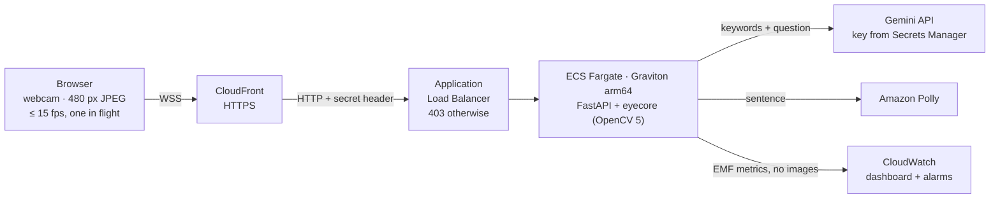

# Eye Lab

The Vakyam eye pipeline as a web service on AWS: open a page, calibrate seven looks with your webcam, answer a
question with your eyes, and hear the sentence Gemini writes from the words you chose. It lets anyone try Vakyam
without an Android phone, and it is the OpenCV 5 + AWS half of the
[OpenCV AI Competition 2026](../docs/hackathon/opencv-aws-2026.md) entry.



## What runs per frame (`eyecore/`)

The same stages as the phone's OpenCV 5 pipeline
([`VisionPipeline`](../app/src/main/java/com/demo/opencv/vision/VisionPipeline.kt)), ported to Python:

| Stage | OpenCV 5 | Module |
|---|---|---|
| Find the face and 5 landmarks | `cv2.FaceDetectorYN` (YuNet, the model bundled in the app) on a 320 px copy | [`face.py`](eyecore/face.py) |
| Check the image | variance of the Laplacian, exposure and backlight, head pose from `cv2.solvePnP` (SQPnP) | [`quality.py`](eyecore/quality.py) |
| Normalise light | `cv2.createCLAHE(2.0, (4, 4))` on the face region | [`pipeline.py`](eyecore/pipeline.py) |
| Cut each eye | one `cv2.warpAffine` per eye, rotated by head roll, scaled by eye distance | [`geometry.py`](eyecore/geometry.py) |
| Match the calibrated looks | `cv2.matchTemplate` `TM_CCOEFF_NORMED`, both eyes summed, clear-winner rule | [`matching.py`](eyecore/matching.py) |
| Turn looks into choices | the phone's time-based dwell selector, ported line for line | [`dwell.py`](eyecore/dwell.py) |
| Calibrate hands-free | settle, steady hold, refuse look-alike and bad-quality captures | [`calibration.py`](eyecore/calibration.py) |

**One difference from the phone:** ML Kit's eyelid contours only exist on Android, so each eye crop is placed from
YuNet's landmarks. By default (`anchor_mode="frozen"`) each eye centre is stored relative to the nose tip, in axes
set by the eye line and scaled by the eye distance, while the user looks straight during calibration. A look moves
both eye points the same way, so neither the eye line nor the nose moves, and the crop stays put on the face.
`anchor_mode="landmark"` centres the crops on YuNet's eye points instead. On the synthetic faces in `tests/` both
classify every look correctly, even when the eye points follow the pupils fully; real-camera data should decide
between them.

Closed eyes are a seventh calibrated template here, because ML Kit's eye-open probability is phone-only.

## Calibration Coach

After calibrating, **Calibration Coach** starts an agent that checks the camera, the templates and every look with
OpenCV 5, fixes what it can (instructing the user, re-recording one look, asking the caregiver), and asks the
caregiver before changing any setting. Gemini decides; a rule policy is the baseline and the fallback.
Design, human control, traces and the evaluation (11/11 simulated faults handled correctly by the rule policy) are in
[`coach/README.md`](coach/README.md).

| Variable | Default | |
|---|---|---|
| `EYELAB_COACH_POLICY` | `gemini` | `rules` to run the baseline only |
| `EYELAB_COACH_EFFORT` | `medium` | Gemini thinking level for coaching decisions (`low`, `medium`, `high`) |

## Run it locally

Python 3.12. From the repository root:

```bash
python -m venv .venv
.venv/Scripts/pip install -r eyelab/requirements-dev.txt     # .venv/bin/pip on macOS/Linux
.venv/Scripts/python -m uvicorn server.app:app --app-dir eyelab --port 8080
```

Open <http://localhost:8080>. Browsers allow the webcam on `localhost`; anywhere else the page needs HTTPS, which
the deployed stack provides (CloudFront, or Caddy in `compute=ec2`). Without a Gemini API key everything works except Gemini: the sentence
comes from the same built-in fallback the phone uses, and the coach runs its rule policy. Without AWS credentials the
browser's own voice reads the sentence instead of Polly.

To use Gemini locally, set `GEMINI_API_KEY` in your shell before starting the server (never put it in a file in the
repository).

## Test

```bash
cd eyelab
../.venv/Scripts/python -m pytest -q
```

103 tests: the pipeline stages, the Calibration Coach (tools, approval gate, fallback, a scripted Gemini loop,
real simulated scenarios, and a live 30-second coaching run over the WebSocket), a drawn face (`tests/synthetic.py`) calibrated and driven through every look under
head tilt and movement in both anchor modes, the WebSocket service with a stand-in for Gemini, the Gemini key (environment or Secrets Manager),
the guard rails and fallbacks, and the CloudWatch metric format. Set `EYELAB_FACE_IMAGE=/path/to/face.jpg` to also run YuNet and the
quality meter on a real photo.

## Deploy to AWS

Needs Docker (with arm64 emulation if you are not on an arm64 machine), Node 18+, AWS credentials, and a Gemini API
key stored once in **AWS Secrets Manager**, in the region you deploy to. The stack never sees the key: it passes the
secret's name to the service and grants its role read access, and the service reads the key when it first needs it.

Put the key in a file outside the repository (so it stays out of your shell history), store it, then delete the file:

```bash
aws secretsmanager create-secret --name vakyam/gemini-api-key --secret-string file://gemini-key.txt
```

To replace the key later, use `aws secretsmanager put-secret-value` with the same `--secret-id`, then restart the
service so it reads the new value. Then deploy:

```bash
cd eyelab/infra
python -m venv .venv && .venv/Scripts/pip install -r requirements.txt
npx aws-cdk@2.1145.0 bootstrap
npx aws-cdk@2.1145.0 deploy --app ".venv/Scripts/python app.py"
```

**On COOL instead of Fargate.** Subscribe to *Cloud Optimized OpenCV for AWS Graviton4* in AWS Marketplace, then:

```bash
npx aws-cdk@2.1145.0 deploy --app ".venv/Scripts/python app.py" -c compute=cool -c cool_ami=ami-...
```

This runs the service on a Graviton4 Auto Scaling group (`c8g.xlarge` by default, `-c cool_instance_type=…`) from
the COOL AMI, inside COOL's own Python environment. An instance refuses to serve unless `cv2` comes from
`/opt/cool`, and `/healthz` then reports `"cool": true`. Shell access is through Systems Manager, with no SSH, and the
service log is shipped to the same CloudWatch log group. The [COOL benchmark](bench/README.md) compares COOL with
stock OpenCV 5 on the same instance.

**On one instance with a fixed IP (the live endpoint).** For a domain that can only point at an IP address, such as
DuckDNS, allocate an Elastic IP once, point the domain at it, then deploy:

```bash
aws ec2 allocate-address --domain vpc --tag-specifications "ResourceType=elastic-ip,Tags=[{Key=project,Value=vakyam}]"
npx aws-cdk@2.1145.0 deploy --app ".venv/Scripts/python app.py" -c compute=ec2 -c domain=eyelab.duckdns.org -c eip_allocation=eipalloc-...
```

This runs the same container on one Graviton `t4g.small` (`-c ec2_instance_type=…`) with standard CPU credits, so a
busy instance slows down instead of billing more. Caddy on the instance gets a Let's Encrypt certificate for the
domain and proxies HTTPS and the WebSocket to the service; only ports 80 and 443 are open. There is no load balancer
or CloudFront, which makes it the cheapest mode to keep running (about USD 0.6 a day in `us-east-1`).

The stack prints `EyeLabUrl` (the HTTPS page), `DashboardName` and `LogGroupName`. Context values
(`-c gemini_model=…` (default `gemini-3.8-flash`), `-c gemini_secret=…` (default `vakyam/gemini-api-key`),
`-c max_sessions=…`, `-c polly_voice=…`, `-c task_cpu=…`, `-c task_memory=…`, `-c max_tasks=…`) override the
defaults. `-c budget_email=…` adds an AWS Budget (USD 30 a quarter, `-c budget_usd=…`) that emails at a third, two
thirds and 90% of it, and when the forecast passes it. `cdk destroy` removes it all.

The Fargate mode:

| Resource | Why |
|---|---|
| VPC, 2 public subnets, no NAT | the task reaches AWS APIs directly; no NAT bill |
| ECS Fargate, arm64 (Graviton), 0.5 vCPU / 1 GB, 1 task (`-c max_tasks=4` scales on CPU) | one uvicorn worker per task; sessions live in memory |
| Application Load Balancer, 300 s idle timeout | long-lived WebSockets; default action is 403 |
| CloudFront, caching off, all viewer headers forwarded | HTTPS for the webcam; carries the WebSocket upgrade; adds the header the ALB checks |
| Task role: read the one Gemini secret, `polly:SynthesizeSpeech` | nothing else |
| CloudWatch log group (30 days), dashboard, two alarms | frame time p95 over 150 ms; five Gemini failures in five minutes |
| Deployment circuit breaker with rollback, 100% minimum healthy | a bad image never replaces a working one; deploys never drop sessions |

## Responsible operation

- **No images are kept.** Frames are decoded, processed in memory and dropped. Logs carry numbers only:
  frame times, rates and counts, never images, keywords or sentences.
- **What leaves AWS:** only the chosen keywords and the caregiver's question, sent to the Gemini API to write the
  sentence, and the coach's numeric OpenCV measurements. Never images.
- **Abuse limits:** at most 20 sessions per task (`EYELAB_MAX_SESSIONS`), 200 KB per frame, bursts above twice
  the 15 fps pace refused, sessions closed after 120 s idle, keywords limited to four short words of letters.
- **Never silent:** if Gemini is unavailable, slow, blocks the answer, or returns a single word or an echo of the keywords,
  the user still gets a complete sentence from the phone's built-in fallback, labelled as such on screen.
- **Human in control:** every tile is also a button; a caregiver can always choose for the user.
- **Not a medical device**, and the demo is not a replacement for a calibrated AAC system.

## Configuration

| Variable | Default | |
|---|---|---|
| `EYELAB_GEMINI_MODEL` | `gemini-3.8-flash` | Gemini model for sentences and the coach |
| `GEMINI_API_KEY` | unset | the key itself; for running locally |
| `EYELAB_GEMINI_SECRET` | unset | Secrets Manager name of the key, used when `GEMINI_API_KEY` is unset (set by the stack) |
| `AWS_REGION` | `us-east-1` | for Secrets Manager and Polly |
| `EYELAB_SENTENCE_TIMEOUT_S` | `10` | then the fallback sentence (Gemini refuses deadlines under 10 s) |
| `EYELAB_POLLY`, `EYELAB_POLLY_VOICE` | `0`, `Joanna` | `1` in the AWS stack |
| `EYELAB_MAX_SESSIONS`, `EYELAB_MAX_FPS`, `EYELAB_MAX_FRAME_BYTES` | `20`, `15`, `204800` | |
| `EYELAB_SESSION_IDLE_S` | `120` | |
| `EYELAB_DEBUG_CROPS_EVERY` | `3` | eye crops sent to the "Under the hood" panel every N frames |
| `EYELAB_MODEL_PATH` | bundled YuNet model | |

## Measured so far

- **Server time per frame:** 6.6 ms at 480 px with real YuNet, on a desktop CPU (Windows, x86). The round trip
  over localhost was 9 ms, and a frame is about 32 KB of JPEG. Not yet measured on Graviton.
- **Synthetic faces:** in both anchor modes, all six choosable looks are selected correctly with the head
  upright, tilted ±10-12°, moved, or both.
- **Not measured yet:** accuracy on real webcams and real users, which needs recorded sessions; latency of
  Gemini and of Polly, which needs a key and the deployed stack.
