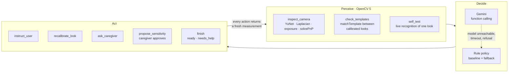

# Calibration Coach

An agent that takes a user from "calibrated" to "every look is recognised reliably", or says honestly that a
person needs to help. It is Vakyam's entry for the **Agentic Vision Award**: what OpenCV 5 measures in the images
decides the coach's next tool call.

## How it works

- **Perceive.** Three OpenCV 5 tools.
  - `inspect_camera` watches the camera for two seconds. It reports YuNet face found rate, face size, brightness,
    variance of the Laplacian, solvePnP yaw and pitch, and the share of frames with each quality issue.
  - `check_templates` compares every pair of calibrated looks with `matchTemplate` and flags pairs closer than
    0.15.
  - `self_test` asks the user to hold one look for 2.5 s. It reports the recognised rate, the best-match rate, the
    per-eye error against the threshold, and what the look was confused with.
- **Decide.** [`gemini.py`](gemini.py) runs a manual function-calling loop with Gemini. The tools are
  async and drive a live camera session, and the fallback must share the same runner, so a manual loop fits better
  than the SDK's automatic function calling. The model writes one sentence of reasoning before each tool call, which becomes the trace.
  The model's turns are appended back exactly as returned, which keeps Gemini's thought signatures. [`rules.py`](rules.py)
  is a fixed procedure over the same tools: it is the baseline Gemini is evaluated against, and it takes over mid-run
  if Gemini fails.
- **Act.**
  - `instruct_user` handles what the user can fix.
  - `recalibrate_look` re-records one template and keeps the others.
  - `ask_caregiver` handles what the user cannot fix.
  - `propose_sensitivity` changes the threshold, but only with the caregiver's approval.
  - `finish` ends the run. Every action returns a fresh measurement, so the next decision is made on what changed.

## Human control and safety

- **Approval gate.** Only `propose_sensitivity` changes a setting, and [`tools.py`](tools.py) applies it only when
  the caregiver taps Approve. No answer within 90 s counts as no. The proposal is bounded to 10-45.
- **No false selections.** After a looser threshold is approved, the coach re-tests the resting look. A threshold
  loose enough to turn resting into a selection would make the patient say things they did not choose.
- **Never the same fix more than twice.** The runner also stops any policy at 24 steps.
- **Honest outcomes.** `ready` only when every choosable look has passed a self test. Otherwise `needs_help`, with
  a summary a caregiver can act on.
- **Validated inputs.** Unknown looks, over-long messages and out-of-range values come back to the policy as error
  results to correct; they never reach the session.
- **Stop button.** The caregiver can end coaching at any time; every tile still works by tap.

## Failure handling and observability

- **Fallback.** If Gemini cannot be reached (no API key, timeout, rate limit, HTTP error), blocks the answer, or stops
  without finishing, the rule policy continues from the same state. The trace marks the hand-over and the reason.
- **Trace.** Every step is traced: the policy, its one-line reasoning, the tool, the input, the full OpenCV result
  and the duration. The page shows it live in the Coach panel.
- **Metrics.** Each run emits CloudWatch EMF metrics: `CoachRuns`, `CoachReady`, `CoachSteps`, `CoachSeconds`,
  `CoachApprovals` and `CoachFallback`, with the outcome and tool sequence as properties.

## Evaluation

[`coach_eval.py`](../coach_eval.py) runs the coach on a drawn face with injected faults, using the real OpenCV 5
pipeline and a simulated user and caregiver who respond to what they are asked, by keyword. After the coach finishes,
the harness measures the **ground truth independently**: it holds and tests every look and checks the resting look
for misreads. A run is **correct** when the coach's outcome agrees with that ground truth.

Rule policy, seed 1 ([`eval_results/coach/results.md`](../eval_results/coach/results.md), full traces in
`results.json`):

| Scenario | Outcome | Ground truth | Correct | Steps | Approvals | Caregiver | Re-records |
|---|---|---|---|---|---|---|---|
| clean | ready | works | yes | 9 | 0 | 0 | 0 |
| weak_up | ready | works | yes | 11 | 0 | 0 | 1 |
| turned_away | ready | works | yes | 10 | 0 | 0 | 0 |
| too_far | ready | works | yes | 10 | 0 | 0 | 0 |
| dark_room | ready | works | yes | 10 | 0 | 1 | 0 |
| dim_room_unfixable | ready | works | yes | 10 | 0 | 1 | 0 |
| very_dark_unfixable | ready | works | yes | 18 | 1 | 1 | 0 |
| no_face | ready | works | yes | 10 | 0 | 1 | 0 |
| no_face_unfixable | needs_help | fails | yes | 3 | 0 | 1 | 0 |
| strict_threshold | ready | works | yes | 12 | 1 | 0 | 0 |
| strict_threshold_denied | needs_help | fails | yes | 10 | 1 | 0 | 0 |

**11/11 correct**, 10.3 steps and about 58 s of simulated time per run.

### What the evaluation changed

Running it found four problems in the first version, each fixed and re-measured:

1. **The coach gave up too early.** In a dim room the caregiver could not fix, it declared `needs_help`, yet every
   look still worked. An issue nobody can fix is now noted, not fatal, and the self tests decide.
2. **Errors in the wrong units.** Self-test errors were summed over both eyes and compared with a per-eye
   threshold. They are now reported per eye.
3. **Six approvals in one run.** It proposed a sensitivity change once per failing look. Now it makes one proposal
   and then re-tests the resting look.
4. **Calibration stalled on a noisy camera.** Closed eyes have little texture, so noise alone failed the
   steadiness check. It now loosens with each re-prompt, as the phone's gate does.

### Two traces

**weak_up.** While calibrating, the user only glanced up a little, so "up" and "straight" look alike.

| # | Tool | What OpenCV measured | What it caused |
|---|---|---|---|
| 1 | inspect_camera | face 100%, no issues | go on to the templates |
| 2 | check_templates | straight/up **0.123** apart, limit 0.15 | re-record **up**, not straight |
| 3 | recalibrate_look up | captured; straight/up now **0.252** | check again |
| 4 | check_templates | no look-alikes | self tests |
| 5-10 | self_test × 6 | every look 100%, error 0.003-0.016 | finish |
| 11 | finish | | **ready** |

**strict_threshold.** The sensitivity was set too strict for a noisy camera.

| # | Tool | What OpenCV measured | What it caused |
|---|---|---|---|
| 3-7 | self_test open looks | 100% recognised | |
| 8 | self_test closed | best match **100%** but recognised **0%**, error **0.105** against a limit of 0.08 | the threshold, not the template, is wrong |
| 9 | propose_sensitivity 10 | caregiver **approved** | re-test |
| 10 | self_test closed | 100% | check for false selections |
| 11 | self_test straight | resting still read as resting, 100% | |
| 12 | finish | | **ready** |

### Limitations

- **The Gemini policy has not been evaluated yet.** It needs a Gemini API key (`GEMINI_API_KEY`, or
  `--secret vakyam/gemini-api-key` with AWS credentials): `python coach_eval.py --policy both`. Its loop, append-only history, fallback and tool handling are covered by
  tests with a scripted stand-in (`tests/test_coach.py`).
- **The faces are drawn, and the user and caregiver are simulated**, reacting to keywords. Real users will be
  slower, misunderstand instructions and get tired. The scenarios test the decisions, not the human factors.
- **Self tests measure the look the user was asked to hold.** They do not catch a user who looks somewhere else.
- **One seed.** Run more with `--seed` before quoting rates.
